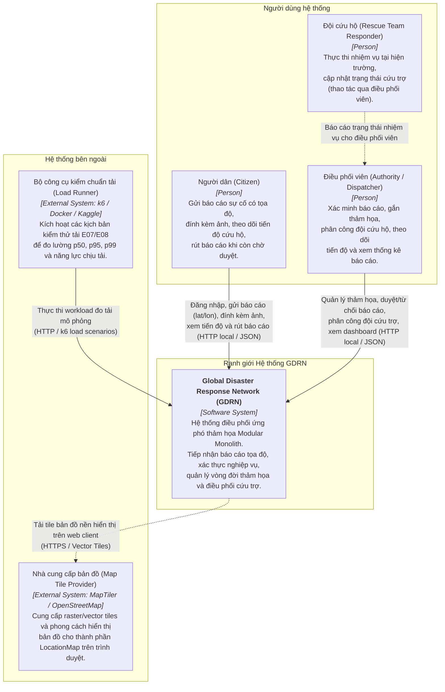
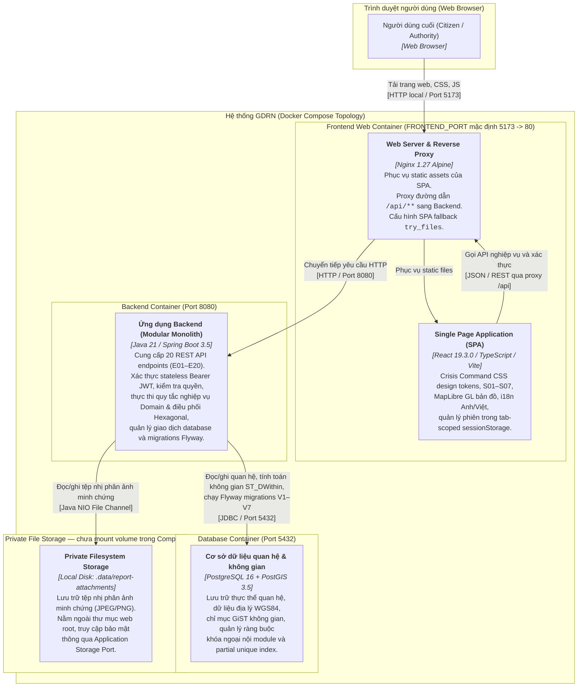
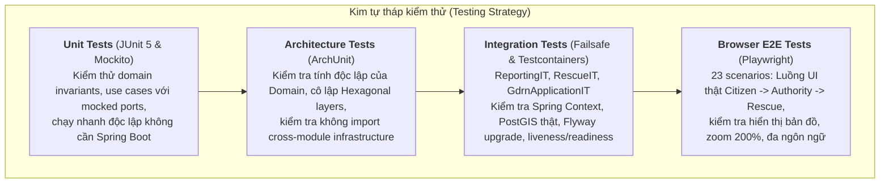

# Kiến trúc hệ thống GDRN

Tài liệu này mô tả kiến trúc tổng thể của hệ thống **Global Disaster Response Network (GDRN)** theo mô hình **C4 (Context, Container, Component)**, kết hợp các nguyên lý **Domain-Driven Design (DDD)** và **Hexagonal / Clean Architecture**.

---

## 1. Tổng quan và Hiện trạng Kiến trúc Pha 1

GDRN là hệ thống mô phỏng điều phối cứu trợ và ứng phó thảm họa thiên tai, phục vụ mục tiêu học thuật và nghiên cứu kiến trúc phần mềm. Đối chiếu mã nguồn tại `main 2ddf9d0`: MVP và phần mở rộng đã có code; kết quả kiểm tra và giới hạn triển khai được ghi riêng trong [biên bản rà soát](../PHASE1_REVIEW.md). Phạm vi hiện có:

- **Kiến trúc phân rã**: Đơn ứng dụng **Modular Monolith** (Java 21 / Spring Boot 3.5) đóng gói trong một tiến trình duy nhất, kết hợp cơ sở dữ liệu **PostgreSQL 16 + PostGIS 3.5**.
- **Giao diện người dùng**: Ứng dụng đơn trang **SPA** (React 19.3.0 / TypeScript / Vite / Vanilla CSS Design Tokens) phục vụ qua Nginx container với reverse proxy `/api`.
- **Hệ thống API nghiệp vụ**: Hoàn thành 20 endpoints nghiệp vụ (E01–E20), bao gồm Identity (E01–E02), Disaster (E03–E06), Reporting (E07–E11), Rescue (E12–E15), Dashboard (E16) và Photo Attachments (E17–E20).
- **Hệ thống màn hình**: 7 màn hình hoàn chỉnh (S01 Login, S02 Gửi báo cáo, S03 Báo cáo của tôi, S04 Điều phối duyệt báo cáo, S05 Quản lý thảm họa, S06 Phân công cứu hộ, S07 Dashboard thống kê).
- **Cơ sở dữ liệu & Không gian**: Quản lý tiến hóa lược đồ qua 7 bản migration Flyway (V1–V7). Xử lý vị trí không gian địa lý WGS84 (SRID 4326) với PostGIS GiST index và JDBC Data Mapper.
- **Bảo mật & Phiên làm việc**: Xác thực stateless Bearer JWT (HS256), phân quyền dựa trên vai trò `CITIZEN` / `AUTHORITY`, lưu trữ token trong `sessionStorage` phạm vi tab trình duyệt, bảo vệ default-deny trên toàn bộ endpoint.
- **Chống xung đột & Concurrency**: Bảo vệ toàn vẹn bằng atomic conditional updates, unique index và partial unique index chống race condition ở tầng database.
- **Đo lường & Kiểm chuẩn**: k6 đã chạy đủ 48/48 lượt trên Kaggle CPU; backend, PostGIS và k6 cùng chạy trên máy Kaggle. Xem [bằng chứng đầy đủ](../benchmark/evidence/kaggle-full-v4/REPORT.md).

---

## 2. Mô hình C4 — Cấp độ 1: Sơ đồ Ngữ cảnh Hệ thống

Sơ đồ ngữ cảnh thể hiện người dùng (Actors), ranh giới của hệ thống GDRN và các hệ thống bên ngoài tương tác với GDRN.



---

## 3. Mô hình C4 — Cấp độ 2: Sơ đồ Container

Sơ đồ Container phân rã hệ thống GDRN thành các thành phần triển khai (containers) ở mức kiến trúc phần mềm, bao gồm SPA Client, Ứng dụng Backend Spring Boot, Cơ sở dữ liệu quan hệ/không gian và Vùng lưu trữ tệp tin riêng tư.



---

## 4. Mô hình C4 — Cấp độ 3: Sơ đồ Thành phần

Sơ đồ Component bóc tách bên trong khối **Backend Spring Boot Application (Modular Monolith)** thành các module nghiệp vụ bounded context, các lớp kiến trúc lục giác (**Hexagonal / Clean Architecture**) và các luồng giao tiếp thông qua **Published Contracts**:

```mermaid
flowchart TD
    subgraph Identity["Identity"]
        IAPI["IdentityController"] --> IAPP["IdentityService / ProvisionDemoAccounts"]
        IAPP --> IDOM["User / EmailAddress / Role"]
        IAPP --> IPORT["AccountStore / Passwords / TokenIssuer ports"]
        IINFRA["JpaAccountStore / EncodedPasswords / JwtConfiguration"] -.->|"implements"| IPORT
    end
    subgraph Disaster["Disaster"]
        DAPI["DisasterController"] --> DAPP["DisasterService"] --> DDOM["Disaster"]
        DAPP --> DPORT["DisasterRepository port"]
        DINFRA["JpaDisasterRepository"] -.->|"implements"| DPORT
        DPUB["PublishedDisasterQuery"] --> DPORT
        DPUB -.->|"implements"| DQUERY["DisasterQuery published contract"]
    end
    subgraph Reporting["Reporting"]
        RAPI["ReportController E07–E11/E17–E20"] --> RAPP["ReportService / ReportModerationService / ReportAttachmentService"]
        RAPP --> RDOM["Report / Coordinates / ReportAttachment"]
        RAPP --> RPORT["ReportStore / DisasterLookup / attachment ports"]
        RINFRA["JdbcReportStore / DisasterQueryAdapter / file adapters"] -.->|"implements"| RPORT
        RPUB["PublishedReportingQuery"] --> RPORT
        RPUB -.->|"implements"| RQUERY["ReportingQuery published contract"]
        RSTAT["JdbcReportStatistics"] -.->|"implements"| RSTATQUERY["ReportStatisticsQuery published contract"]
    end
    subgraph Rescue["Rescue"]
        CAPI["RescueController"] --> CAPP["RescueService"] --> CDOM["Mission / RescueTeam"]
        CAPP --> CPORT["MissionRepository / RescueTeamRepository / ReportLookupPort"]
        CINFRA["JdbcMissionStore / JdbcRescueTeamStore / ReportingQueryAdapter"] -.->|"implements"| CPORT
        CSTAT["JdbcRescueStatistics"] -.->|"implements"| CSTATQUERY["RescueStatisticsQuery published contract"]
    end
    subgraph Dashboard["Dashboard — read use case, không có domain aggregate"]
        BAPI["DashboardController"] --> BAPP["DashboardService"] --> BPORT["DashboardStatistics port"]
        BINFRA["ModuleDashboardStatistics / REPEATABLE READ"] -.->|"implements"| BPORT
    end
    RINFRA -->|"DisasterQueryAdapter"| DQUERY
    CINFRA -->|"ReportingQueryAdapter"| RQUERY
    BINFRA --> RSTATQUERY
    BINFRA --> CSTATQUERY
    SHARED["shared: SecurityConfiguration / ApiError / OpenApiConfiguration"]
```



Mũi tên thể hiện phụ thuộc mã nguồn/contract; nét đứt là hiện thực interface,
không phải luồng xử lý HTTP. Spring configuration nối services với adapters lúc
khởi tạo. `shared` giữ technical concerns; filter security áp dụng trước controller.


---

## 5. Nguyên lý Thiết kế và Quy tắc Kiến trúc

### 5.1. Kiến trúc Lục giác
Mỗi module nghiệp vụ tuân thủ nghiêm ngặt nguyên lý phụ thuộc hướng tâm (**Dependencies point inward**):

```text
API (Controllers, DTOs)
  └──> Application (Use Cases, Commands, Queries, Ports, Contracts)
        └──> Domain (Entities, Value Objects, Domain Invariants - Pure Java)
Infrastructure (Persistence, Adapters, Spring Security, External Storage)
  └──> Implements Application & Domain Ports
```

- **Domain độc lập tuyệt đối**: Viết hoàn toàn bằng Java thuần (POJO), không chứa bất kỳ annotation hay import nào từ Spring Framework, Jakarta Persistence (JPA), Jackson JSON hay PostgreSQL/PostGIS. Toàn bộ quy tắc tính hợp lệ và biến đổi trạng thái (Invariants) được thực thi trong Domain.
- **Application Port / Adapter**: Mọi giao tiếp với thế giới bên ngoài (cơ sở dữ liệu, lưu trữ tệp, xác thực token) đều thông qua Interface (Port) định nghĩa ở tầng Application. Tầng Infrastructure cung cấp Adapter hiện thực các Interface này.
- **Kiểm soát bằng ArchUnit**: Bộ kiểm tra kiến trúc tự động (`ArchitectureTests`) xác thực tính độc lập của Domain, ngăn chặn controller truy cập trực tiếp repository và cấm rò rỉ cơ sở hạ tầng giữa các module.

### 5.2. Giao tiếp liên Module và Ranh giới Dữ liệu
Dự án áp dụng mô hình **Modular Monolith** chặt chẽ, không biến tướng thành "Distributed Monolith" hoặc Microservices phức tạp không cần thiết:

1. **Chiều phụ thuộc đơn hướng**:
   $$\text{Rescue} \longrightarrow \text{Reporting} \longrightarrow \text{Disaster}$$
   $$\text{Dashboard} \longrightarrow \text{Reporting} \quad \text{và} \quad \text{Dashboard} \longrightarrow \text{Rescue}$$
2. **Không join SQL hoặc liên kết JPA xuyên module**:
   - Mỗi module sở hữu toàn bộ bảng và dữ liệu của riêng mình. Không tồn tại Foreign Key vật lý xuyên qua các bảng của module khác.
   - Các tham chiếu liên module (`reporterId`, `disasterId`, `reportId`) được lưu trữ dưới dạng định danh vô hướng `UUID`.
   - Tính toàn vẹn dữ liệu được đảm bảo thông qua logic ứng dụng và các **Published Application Contracts** (`DisasterQuery`, `ReportingQuery`).
3. **Published Application Contracts**:
   - Nằm tại `<module>.application.contract`, chỉ chứa Java Interface và DTO immutable (`record`), hoàn toàn không phụ thuộc Spring hay JPA.
   - Khi module A cần dữ liệu từ module B, Adapter của module A gọi Interface Contract được xuất bản của module B. Dữ liệu trả về là các snapshot bất biến (ví dụ: `DisasterSnapshot`, `ReportSnapshot`).

---

## 6. Chiến lược Dữ liệu, Không gian và Xử lý Đồng thời

### 6.1. Tiến hóa Schema với Flyway
Hệ thống sử dụng một cơ sở dữ liệu duy nhất với 7 bản migration tuần tự bất biến:

| Version | File Migration | Module Sở Hữu | Nội dung Schema & Ràng buộc |
| :---: | :--- | :---: | :--- |
| **V1** | `V1__enable_postgis.sql` | Technical | Kích hoạt extension PostGIS cho tính toán địa lý. |
| **V2** | `V2__identity_accounts.sql` | Identity | Bảng `identity_users` và `identity_credentials` (FK nội bộ). |
| **V3** | `V3__disasters.sql` | Disaster | Bảng `disasters`, ràng buộc trạng thái ACTIVE/RESOLVED, tọa độ WGS84, version lock. |
| **V4** | `V4__reporting_reports.sql` | Reporting | Bảng `reporting_reports`, cột `geography(Point, 4326)`, ràng buộc ban đầu PENDING. |
| **V5** | `V5__reporting_verification_withdrawal.sql` | Reporting | Mở rộng trạng thái VERIFIED/REJECTED, metadata rút báo cáo `withdrawn_at`, GiST index không gian. |
| **V6** | `V6__rescue_teams_and_missions.sql` | Rescue | Bảng `rescue_teams` và `rescue_missions`, UNIQUE `report_id`, partial unique index cho active team. |
| **V7** | `V7__reporting_evidence_attachments.sql` | Reporting | Bảng `reporting_report_attachments`, metadata ảnh minh chứng, CHECK 5 MiB/ảnh và FK nội Reporting; mức 5 ảnh/báo cáo do application + adapter kiểm soát. |

### 6.2. Dữ liệu Không gian PostGIS
- Lưu trữ tọa độ theo hệ quy chiếu chuẩn WGS84 (SRID 4326) bằng kiểu dữ liệu `geography(Point, 4326)`.
- Thực hiện truy vấn lọc bán kính bằng hàm PostGIS chuyên dụng:
  ```sql
  ST_DWithin(r.location, ST_SetSRID(ST_MakePoint(:lon, :lat), 4326)::geography, :radiusMeters)
  ```
- Sử dụng chỉ mục không gian **GiST** (`reporting_reports_visible_location_idx`) trên tập các báo cáo nhìn thấy được (chưa rút) để tối ưu hóa hiệu năng truy vấn lọc theo vùng địa lý.
- Truy vấn thông qua **JDBC Data Mapper** (`JdbcReportStore`) thuần SQL, loại bỏ phụ thuộc nặng nề vào Hibernate Spatial trong khi vẫn đảm bảo độ chính xác tính toán theo mét thực tế trên mặt cầu Trái Đất.

### 6.3. Kiểm soát Giao dịch và Xử lý Đồng thời
1. **Duyệt / Từ chối / Rút báo cáo (Reporting)**:
   - Sử dụng cơ chế khóa lạc quan (Optimistic Concurrency) với Atomic Conditional Update:
     ```sql
     UPDATE reporting_reports
     SET status = :newStatus, version = version + 1, ...
     WHERE id = :id AND version = :expectedVersion AND status = 'PENDING' AND withdrawn_at IS NULL
     ```
   - Nếu số dòng cập nhật trả về là 0, hệ thống phát hiện có tranh chấp đồng thời và trả về lỗi `409 Conflict`.
2. **Phân công đội cứu hộ (Rescue)**:
   - Mỗi báo cáo chỉ được phép có tối đa 1 nhiệm vụ cứu hộ trong toàn bộ vòng đời: ràng buộc `UNIQUE (report_id)` trên bảng `rescue_missions`.
   - Một đội cứu hộ chỉ được phép phụ trách 1 nhiệm vụ đang hoạt động tại một thời điểm: bảo vệ bằng **Partial Unique Index** tầng cơ sở dữ liệu:
     ```sql
     CREATE UNIQUE INDEX idx_rescue_missions_team_active
     ON rescue_missions (team_id)
     WHERE status IN ('ASSIGNED', 'IN_PROGRESS');
     ```
   - Xung đột tranh chấp đội cứu trợ được giải quyết triệt để ở tầng database, ngăn chặn hoàn toàn race condition khi có 2 yêu cầu phân công cùng lúc.
3. **Thống kê Dashboard**:
   - Sử dụng giao dịch `READ ONLY` với mức độ cô lập `REPEATABLE READ` trên cùng DataSource.
   - Đảm bảo tính nhất quán dữ liệu xuyên suốt giữa số lượng báo cáo và nhiệm vụ cứu trợ trong một snapshot thống kê duy nhất mà không gây nghẽn khóa ghi (write locks).

---

## 7. Mô hình Bảo mật và Quản lý Phiên

- **Stateless Bearer JWT**: Token JWT ngắn hạn được ký bằng thuật toán HS256 với secret key nạp từ biến môi trường. Không lưu trạng thái phiên trên server (Stateless).
- **Tab-scoped Session**: Frontend lưu token trong `sessionStorage`, khóa `gdrn.session`; reload cùng tab giữ phiên đến hết hạn. Logout/hết hạn xóa phiên; không có refresh token. Storage fallback dùng memory khi trình duyệt chặn storage. Không coi tab scope là bảo vệ trước XSS hoặc việc trình duyệt sao chép/khôi phục tab.
- **Default-Deny Security Filter**: Cấu hình Spring Security áp dụng quy tắc mặc định từ chối (`anyRequest().denyAll()`). Từng endpoint được khai báo chính xác phương thức HTTP và quyền tương ứng (`ROLE_CITIZEN`, `ROLE_AUTHORITY`).
- **Phân quyền dữ liệu ở Application Layer**:
  - Người dân (`CITIZEN`) chỉ được đọc và thao tác trên báo cáo do chính mình tạo ra (`reporterId == currentUserId`).
  - Điều phối viên (`AUTHORITY`) có quyền xem toàn bộ báo cáo và nhiệm vụ điều phối.
  - Tải ảnh minh chứng đính kèm được bảo vệ thông qua endpoint có xác thực; hệ thống không phát hành public URL cho tệp nhị phân.

---

## 8. Chiến lược Kiểm thử và CI/CD

Kiến trúc GDRN được thiết kế để kiểm thử toàn diện trên nhiều cấp độ:



- **Clean Verify**: Lệnh `.\mvnw.cmd clean verify` chạy trọn vẹn toàn bộ Unit Tests, Architecture Tests và Integration Tests với Testcontainers (yêu cầu Docker daemon).
- **Frontend Verify**: Lệnh `npm ci`, `npm run typecheck`, `npm test` và `npm run build` xác thực 93 unit tests giao diện, tính tương thích TypeScript và đóng gói production bundle.
- **Continuous Integration (CI)**: GitHub Actions workflow tự động kiểm tra cú pháp Compose, chạy clean verify, build frontend/backend image, khởi động stack kiểm tra healthcheck và chạy bộ hồi quy Playwright browser test.
- **Đo lường Hiệu năng k6 (Performance Benchmark Task D3)**: Hệ thống duy trì bộ kịch bản kiểm thử tải k6 có khả năng tái lập cao tại `benchmark/`, đo lường throughput, p50, p95, p99 và tài nguyên Docker stats trên cơ sở dữ liệu thật PostGIS.

### 8.4. Đo lường Hiệu năng & Nền tảng cơ sở Tải Thực nghiệm

Để phục vụ phân tích kiến trúc dựa trên bằng chứng định lượng (empirical evidence) thay vì cảm tính, hệ thống đã thực thi bộ kiểm chuẩn tải k6 (Task D3) đo lường các workload đọc/ghi trên cơ sở dữ liệu disposable PostGIS riêng biệt (xem chi tiết tại [Handoff D3](../handoffs/D3.md) và [D3 Benchmark Contract](../benchmark/D3.md)):

- **Cấu hình môi trường đo lường:** Host Windows 11 (Acer Nitro AN515-58, Intel Core i5-12500H, 16 logical processors, 15.7 GiB RAM), Docker Desktop Engine 27.3.1, container `grafana/k6` kết nối tới Backend host qua `host.docker.internal`, cơ sở dữ liệu PostGIS 16-3.5.
- **Dữ liệu mẫu thực nghiệm:** Sinh ngẫu nhiên xác định với 70% mật độ tập trung / 30% phân tán rộng qua `benchmark/generate_reports.py`.

#### Bảng Số Liệu Đo Tải Thực Nghiệm k6 (Dẫn xuất từ Bàn giao D3)

| Workload | Endpoint / Hợp đồng | Dataset | VUs | Requests/s | Avg / p50 / p95 / p99 (ms) | Error rate | Kích thước Artifact thô |
| :--- | :--- | :---: | :---: | :---: | :---: | :---: |
| **E07 Write** | `POST /api/reports` | DB rỗng sau reset | 1 | **164.57** | 3.81 / 3.67 / 4.98 / **5.82** | 0% | 5.15 MiB |
| **E08 Page Smoke** | `GET /api/reports` | 100 reports | 1 | **137.71** | 5.00 / 4.73 / 7.67 / **10.85** | 0% | 8.97 MiB |
| **E08 Radius Smoke** | `GET /api/reports` (`ST_DWithin`) | 100 reports | 1 | **156.06** | 4.31 / 4.10 / 5.85 / **7.78** | 0% | 11.68 MiB |
| **E08 Page Ladder** | `GET /api/reports` (Phân trang) | 1,000 reports | 10 | **928.17** | 7.23 / 6.49 / 12.58 / **17.55** | 0% | 60.49 MiB |
| **E08 Page Ladder** | `GET /api/reports` (Phân trang) | 1,000 reports | 50 | **1,439.13** | 18.93 / 17.35 / 36.35 / **48.63** | 0% | 117.63 MiB |
| **E08 Page Ladder** | `GET /api/reports` (Phân trang) | 1,000 reports | 100 | **1,996.98** | 34.93 / 30.19 / 78.70 / **105.28** | 0% | 130.06 MiB |

#### Giám Sát Tài Nguyên Container

| Tải người dùng | Backend CPU (TB / Đỉnh) | Backend RAM Đỉnh | Database CPU (TB / Đỉnh) | Database RAM Đỉnh |
| :---: | :---: | :---: | :---: | :---: |
| **10 VU** | 208.68% / 790.33% | 7.56% (~1.18 GiB) | 69.92% / 212.42% | 2.14% (~344 MiB) |
| **50 VU** | 306.05% / 451.29% | 8.87% (~1.39 GiB) | 142.44% / 324.68% | 2.14% (~344 MiB) |
| **100 VU** | 238.21% / 494.43% | 9.22% (~1.45 GiB) | 194.88% / 333.07% | 2.15% (~345 MiB) |

- **Bảo mật và Tái lập trong Benchmark:**
  - JWT token được cấp phát với thời hạn 900 giây, bảo đảm bao phủ toàn bộ chu kỳ warm-up, steady run và ramp-down mà không gây lỗi giả tạo do hết hạn token.
  - Công cụ runner tự động lọc bỏ (redact) setup JWT token trước khi lưu `summary.json` và kiểm tra an toàn dữ liệu thô.
  - Bounded in-flight requests ngăn chặn tình trạng tràn bộ đệm k6 client.
  - Kết quả thô được lưu trữ tại `benchmark/results/20261024-142105-01` đến `benchmark/results/20261024-142703-01`.
