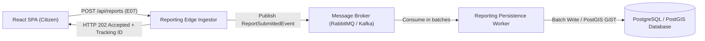

# Tài Liệu Đặc Tả Kỹ Thuật (RFC) — Tiếp Nhận Tin Báo Bất Đồng Bộ Qua Message Queue (Pha 2)

> **Mã tài liệu:** `RFC-011-ASYNC-INGESTION`
> **Trạng thái:** Bản thảo nghiên cứu (Draft Proposal for Phase 2)
> **Cơ sở khoa học:** Dựa trên kết quả đo kiểm chuẩn hiệu năng Task D3 ([docs/benchmark/D3.md](../benchmark/D3.md))

---

## 1. Đặt Vấn Đề
Trong kiểm thử tải k6 Task D3, khi tăng số lượng người dùng đồng thời lên 100 VU với lưu lượng gần 2,000 req/s, độ trễ p99 tăng từ 5.82 ms (ở 1 VU) lên 105.28 ms. Điểm nghẽn cốt lõi nằm ở cơ chế kết nối HTTP Request-Response đồng bộ (Synchronous Coupling):
- Mỗi request gửi báo cáo (`E07 POST /api/reports`) giữ một thread của Spring Boot Tomcat pool.
- Quá trình xác thực JWT, giải mã hình học WGS84, mã hóa nhị phân PostGIS và ghi đĩa cơ sở dữ liệu làm cạn kiệt tài nguyên thread pool trong các tình huống đột biến tải (Flash Crowd).

---

## 2. Thiết Kế Kiến Trúc Đề Xuất

### 2.1. Thành phần kiến trúc
1. **Reporting Edge Ingestor:** Nhận HTTP POST, xác thực token JWT, kiểm tra validation cơ bản và đẩy sự kiện `ReportSubmittedEvent` vào Message Broker trong < 2 ms.
2. **Message Broker (RabbitMQ / Kafka):** Đóng vai trò bộ đệm lưu trữ bền vững (Durable Buffer) với chính sách `at-least-once delivery`, ngăn chặn quá tải đè bẹp cơ sở dữ liệu.
3. **Reporting Persistence Worker:** Tiêu thụ tin nhắn theo cơ chế gom cụm (Batch Processing), thực hiện các phép tính trắc địa và ghi xuống PostGIS với tốc độ ổn định.

---

## 3. Lợi Ích & Đánh Đổi Kiến Trúc
- **Lợi ích:**
  - Triệt tiêu hoàn toàn hiện tượng nghẽn thread pool; độ trễ phản hồi phía client giảm xuống < 10 ms ngay cả ở mức tải 5,000 req/s.
  - Tách rời tính khả dụng của luồng tiếp nhận tin báo khỏi tình trạng quá tải tức thời của cơ sở dữ liệu.
- **Đánh đổi:**
  - Chuyển từ tính nhất quán tức thì (Strong Consistency) sang tính nhất quán cuối cùng (Eventual Consistency): người dân nhận HTTP `202 Accepted` và báo cáo xuất hiện trong danh sách sau 100–300 ms.
