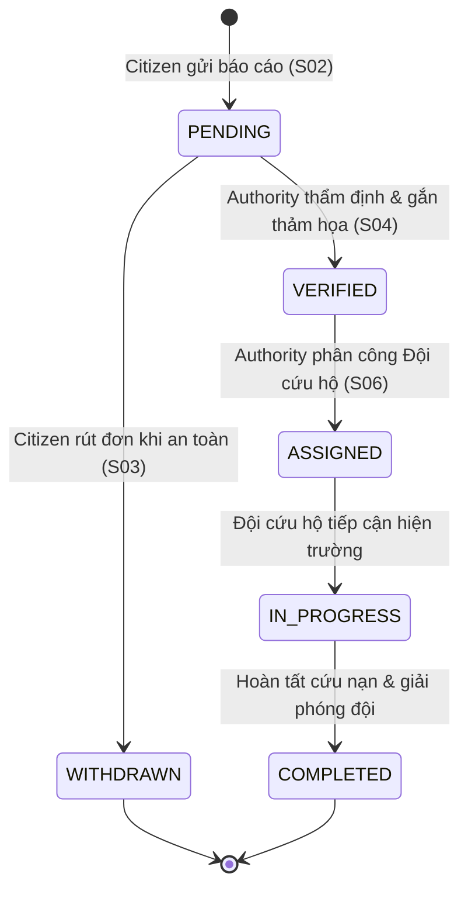

# Kịch Bản Trình diễn Hệ Thống & Bảng Đối Chiếu Tiêu Chí Pha 1

> **Nhánh:** `feat/c3-architecture-docs` | **Commit cơ sở:** `c99ebd5`
> **Vai trò phân tích & xây dựng:** Business Analyst (BA), Software QA Tester & Chuyên gia trình bày sản phẩm phần mềm.
> **Mục tiêu tài liệu:** Cung cấp kịch bản thuyết trình và trình diễn thực chiến trong **5 – 7 phút (mục tiêu chuẩn: 6 phút / 360 giây)** trên đúng **6 màn hình nghiệp vụ thực tế**, tích hợp đầy đủ bảng ma trận đối chiếu 22 tiêu chí tiêu chí đánh giá môn học theo [Mục 27 GDRN_PROJECT_CONTEXT.md](../../GDRN_PROJECT_CONTEXT.md#phase1-acceptance) và kế hoạch [Công việc C3 PHASE1_PLAN.md](../PHASE1_PLAN.md#c3).

---

## PHẦN 1 – Tổng Quan Bài Toán Thực Tế

### A. Bài toán thực tế & Bối cảnh thiên tai
1. **Vấn đề hệ thống giải quyết:**
   Trong các đợt thiên tai quy mô lớn (như bão lũ lịch sử, ngập úng đô thị, sạt lở đất), kênh tiếp nhận tin báo cứu trợ truyền thống (đường dây nóng 112/114/115, nhóm cứu trợ mạng xã hội, tin nhắn SMS) rơi vào tình trạng quá tải và đứt gãy thông tin nghiêm trọng.
2. **Đối tượng sử dụng mục tiêu:**
   - **Người dân (Người dân):** Nạn nhân hoặc nhân chứng trực tiếp tại vùng rốn lũ, khu vực chia cắt; cần gửi yêu cầu cứu nạn khẩn cấp kèm vị trí chính xác và theo dõi xem có ai tiếp nhận cứu hộ mình hay chưa.
   - **Điều phối viên cứu nạn (Điều phối viên):** Cán bộ trực ban tại Trung tâm Chỉ huy Điều phối Ứng phó Thiên tai; cần tổng hợp tin báo, thẩm định thông tin thực địa, khoanh vùng thảm họa và điều động lực lượng giải cứu.
   - **Đội cứu trợ (Rescue Team):** Lực lượng xung kích tại hiện trường; nhận lệnh điều động, tiếp cận tọa độ mục tiêu và thực thi nhiệm vụ giải cứu nạn nhân.
3. **Khó khăn thực tế khi chưa có hệ thống:**
   - *Về phía Người dân:* Hoảng loạn, tin báo qua điện thoại hoặc mạng xã hội hoàn toàn thiếu tọa độ chuẩn (chỉ miêu tả cảm tính: *"nhà tôi ở cạnh bụi tre"*, *"gần quán nước đầu làng"*). Khi lũ dâng xóa nhòa mọi dấu mốc, lực lượng cứu nạn mất hàng giờ đồng hồ tìm kiếm trong vô vọng. Do không biết tin báo đã được ai đọc chưa, người dân liên tục gọi điện và đăng tin lặp lại, tạo nên tình trạng nhiễu loạn thông tin.
   - *Về phía Cơ quan điều phối:* Không có bức tranh tổng thể về thảm họa; dữ liệu rời rạc từ hàng chục nguồn khiến lực lượng cứu hộ bị điều động chồng chéo (nhiều đội cùng đến một điểm ngập nông) trong khi các khu vực ngập sâu, cô lập hoàn toàn lại bị bỏ quên trong "giờ vàng" cứu nạn.
4. **Hậu quả đối với quy trình cứu trợ khẩn cấp:**
   Lãng phí nghiêm trọng phương tiện cứu nạn (xuồng cao tốc, trực thăng, nhân lực), làm chậm trễ thời gian vàng tiếp cận nạn nhân, đe dọa trực tiếp đến tính mạng và tài sản của nhân dân.

### B. Quy trình nghiệp vụ khép kín
Hệ thống GDRN số hóa và khép kín toàn bộ vòng đời tin báo cứu hộ qua 4 giai đoạn chuẩn mực:
1. **Khởi tạo tin báo (Người dân):** Người dân định vị trực tiếp trên bản đồ số chuẩn không gian WGS84, chọn loại thiên tai, mức độ khẩn cấp, đính kèm hình ảnh và gửi báo cáo. Tin báo mang trạng thái ban đầu là `PENDING` (Đang chờ duyệt).
2. **Quản lý & Rút đơn an toàn (Người dân):** Người dân theo dõi tiến độ xử lý theo thời gian thực. Nếu nước đã rút hoặc đã tự di tản an toàn, người dân có quyền chủ động **Rút báo cáo** (`DELETE`) để tránh lãng phí nguồn lực xã hội. Quyền riêng tư được bảo vệ nghiêm ngặt: người dân này tuyệt đối không thể xem hay can thiệp vào tin báo của người khác.
3. **Kích hoạt thảm họa & Thẩm định không gian (Điều phối viên):** Điều phối viên công bố thảm họa diện rộng (`ACTIVE`). Sử dụng công nghệ không gian địa lý PostGIS, hệ thống quét bán kính ảnh hưởng (`ST_DWithin`) xung quanh tâm thảm họa để lọc ra các tin báo lân cận. Điều phối viên xác minh hiện trường và phê duyệt báo cáo sang trạng thái `VERIFIED`.
4. **Điều phối cứu hộ & Giải phóng tài nguyên (Điều phối viên & Rescue Team):** Điều phối viên chọn một Đội cứu hộ đang rảnh (`AVAILABLE`) để phân công nhiệm vụ (`ASSIGNED`). Trạng thái nhiệm vụ luân chuyển: `ASSIGNED` → `IN_PROGRESS` → `COMPLETED`. Khi hoàn tất, đội cứu hộ được tự động giải phóng về trạng thái sẵn sàng (`AVAILABLE`), và người dân nhận được thông báo giải cứu thành công.



### C. Những vấn đề dễ nhận thấy (Điểm sáng nghiệp vụ & Giới hạn thực tế)

#### 1. Các vấn đề nghiệp vụ đã giải quyết triệt để trong phiên bản hiện tại
- **Chuẩn hóa tọa độ địa lý chính xác:** Xóa bỏ hoàn toàn tin báo mơ hồ bằng bản đồ tương tác chuẩn hình học PostGIS WGS84 (`SRID 4326`), lưu trữ chính xác kinh độ/vĩ độ đến từng mét.
- **Lọc không gian siêu tốc:** Ứng dụng hàm trắc địa `ST_DWithin` trên chỉ mục không gian `GiST`, giúp điều phối viên quét toàn bộ tin báo trong bán kính 1–10 km chỉ trong vài mili-giây.
- **Kiểm soát xung đột tương tranh (Kiểm soát tranh chấp đồng thời):** Ngăn chặn triệt để bài toán tranh chấp tài nguyên (nhiều điều phối viên cùng điều một đội cứu hộ) bằng cơ chế cập nhật điều kiện nguyên tử (*Atomic Conditional Update*) ở tầng cơ sở dữ liệu.
- **Bảo mật & Cô lập dữ liệu (Data Isolation):** Áp dụng nguyên tắc `Default-Deny` và phản hồi mã lỗi `404 Not Found` (thay vì `403`) khi người dùng truy cập trái phép báo cáo của người khác, triệt tiêu nguy cơ rà quét dữ liệu nạn nhân (Data Enumeration).

#### 2. Các hạn chế kỹ thuật còn tồn tại trong Pha 1 (Đánh giá trung thực để cải tiến Pha 2)
- **Khớp nối đồng bộ HTTP (Synchronous Yêu cầu-Response Coupling):** Khi bão lũ đổ bộ và hàng ngàn người dân cùng gửi báo cáo (Flash Crowd), kết nối HTTP đồng bộ giữ chân thread pool của máy chủ. Kiểm thử tải k6 (Công việc D3) cho thấy khi tải tăng lên 100 VU, độ trễ p99 tăng lên 105 ms.
  *→ Giải pháp đề xuất Pha 2:* Tích hợp Hàng đợi thông điệp (RabbitMQ / Kafka) để tiếp nhận tin báo bất đồng bộ.
- **Phụ thuộc vào kết nối mạng tải Tile bản đồ (Online Map Tile Dependency):** Thành phần bản đồ số hiện sử dụng ô bản đồ vệ tinh từ MapTiler/OSM. Nếu khu vực bão lũ bị đứt cáp quang hoặc mất Internet, bản đồ có thể không tải được lớp nền hình ảnh.
  *→ Giải pháp đã có trong Pha 1:* Hệ thống đã tích hợp sẵn chế độ **Nhập tọa độ thủ công (Manual Coordinates Fallback)**.
- **Lưu trữ tệp minh chứng trên ổ cứng cục bộ (Local Filesystem Attachment Storage):** Các hình ảnh minh chứng hiện trường hiện được lưu trữ trực tiếp vào thư mục đĩa của máy chủ (`.data/report-attachments`), chưa sử dụng dịch vụ lưu trữ phân tán Object Storage (như AWS S3 / MinIO), gây hạn chế khi mở rộng máy chủ đa cụm (Multi-node Cluster).
- **Đặc tính của Stateless JWT không hỗ trợ thu hồi tức thì (Token Revocation Trade-off):** Token JWT có thời hạn 1 giờ. Nếu một tài khoản bị vô hiệu hóa, token đã phát hành vẫn có hiệu lực cho đến khi hết hạn (trừ khi người dùng chủ động đăng xuất khỏi tab trình duyệt).

---

## PHẦN 2 – Bảng Phân Bổ Thời Gian Trình diễn (Tổng: 360 Giây / 6 Phút)

Kịch bản được tối ưu hóa cho thời lượng **6 phút (360 giây)**, kết hợp hài hòa giữa thuyết trình bài toán, thao tác nghiệp vụ thực tế và phân tích giải pháp kỹ thuật qua đúng 6 màn hình:

| STT | Màn hình | Vai trò | Nội dung chính | Thời gian |
|:---:|---|:---:|---|:---:|
| **1** | **S01 — Đăng nhập & Xác thực** (`/login`) | Diễn giả / Người dân 1 | Giới thiệu bài toán khủng hoảng thông tin, xác thực tài khoản, phân định vai trò bảo mật | **50 giây** |
| **2** | **S02 — Tiếp nhận tin báo tọa độ** (`/reports/new`) | Người dân 1 | Ghim vị trí WGS84 trên bản đồ số, gửi yêu cầu cứu trợ khẩn cấp | **65 giây** |
| **3** | **S03 — Báo cáo cá nhân & Rút đơn** (`/my-reports`) | Người dân 1 & Người dân 2 | Theo dõi trạng thái `PENDING`, rút đơn khi an toàn, kiểm chứng cô lập dữ liệu nạn nhân | **60 giây** |
| **4** | **S05 — Kích hoạt thảm họa** (`/operations/disasters`) | Điều phối viên | Đăng nhập điều phối, công bố thảm họa diện rộng `ACTIVE` làm trung tâm chỉ huy | **55 giây** |
| **5** | **S04 — Thẩm định & Lọc không gian** (`/operations/reports`) | Điều phối viên | Quét bán kính PostGIS 5 km, thẩm định hiện trường, phê duyệt `VERIFIED` gắn vào thảm họa | **65 giây** |
| **6** | **S06 — Phân công cứu hộ & Chống xung đột** (`/operations/rescue`) | Điều phối viên | Phân công đội cứu trợ, minh họa chặn lỗi `409 TEAM_BUSY`, hoàn tất chu trình giải cứu | **65 giây** |
| | **TỔNG CỘNG** | | **Chu trình nghiệp vụ khép kín từ Người dân đến Điều phối cứu hộ** | **360 giây** |

---

## PHẦN 3 – Kịch Bản Chi Tiết Cho 6 Màn Hình

---

### Màn hình 1 – S01: Đăng Nhập & Xác Thực Vai Trò

- **Thời lượng:** 50 giây (00:00 – 00:50)
- **URL/Route:** `http://127.0.0.1:5173/login`
- **Tài khoản sử dụng:**
  - Vai trò: `CITIZEN` (Người dân)
  - Tên tài khoản trình diễn: Tài khoản Người dân 1
  - Biến môi trường liên quan: `DEMO_CITIZEN_ONE_EMAIL` và `DEMO_CITIZEN_ONE_PASSWORD`
- **Mục đích trình bày:** Giới thiệu bối cảnh khủng hoảng thông tin cứu trợ và chứng minh cơ chế phân quyền bảo mật của hệ thống. Hệ thống phân định rạch ròi giữa người dân gửi tin báo và điều phối viên chỉ huy ngay từ cửa ngõ xác thực, ngăn chặn hoàn toàn việc can thiệp trái phép vào hệ thống chỉ huy.
- **Lời thoại chi tiết:**
  *"Kính thưa Quý Thầy/Cô và Hội đồng, hệ thống GDRN được xây dựng nhằm giải quyết bài toán đứt gãy thông tin trong ứng phó thiên tai khẩn cấp. Khi bão lũ xảy ra, các cổng thông tin công cộng rất dễ bị quá tải hoặc spam dữ liệu giả mạo. Vì vậy, hệ thống bắt buộc phân định rõ hai nhóm người dùng ngay từ đầu: Người dân báo nạn và Điều phối viên cơ quan chức năng.*
  *Tại màn hình Đăng nhập S01, hệ thống cung cấp cổng xác thực an toàn bằng mật khẩu băm chuẩn BCrypt và cấp phát Bearer JWT token lưu trữ trong bộ nhớ phiên tab. Em đăng nhập bằng tài khoản Người dân 1 được cấu hình sẵn trong biến môi trường `DEMO_CITIZEN_ONE_EMAIL`. Ngay khi đăng nhập thành công, hệ thống nhận diện vai trò `CITIZEN` và chỉ cấp quyền vào các tính năng gửi báo cáo và theo dõi cứu hộ, ngăn chặn triệt để mọi hành vi can thiệp vào bảng điều khiển tác chiến của chính quyền."*
- **Các thao tác trình diễn:**

| Bước | Thao tác cụ thể | Dữ liệu sử dụng | Kết quả mong đợi |
|:---:|---|---|---|
| 1 | Mở màn hình đăng nhập | Truy cập `/login` | Giao diện đăng nhập GDRN Crisis Command hiển thị chuyên nghiệp, hỗ trợ chuyển đổi Tiếng Việt / Tiếng Anh. |
| 2 | Nhập thông tin tài khoản Người dân | Email từ `DEMO_CITIZEN_ONE_EMAIL`<br/>Mật khẩu từ `DEMO_CITIZEN_ONE_PASSWORD` | Các trường nhập liệu nhận giá trị; mật khẩu được che ký tự an toàn. |
| 3 | Nhấn nút "Đăng nhập" | Click chuột vào nút Đăng nhập | Gọi API `POST /api/auth/login` thành công (200 OK), cấp token JWT và tự động điều hướng sang `/my-reports`. Thanh Header hiển thị nhãn vai trò `CITIZEN`. |

- **Điểm cần nhấn mạnh:** Token được quản lý an toàn trong `sessionStorage`, tự động hủy khi đóng tab, triệt tiêu nguy cơ rò rỉ token qua các tab khác hoặc tấn công CSRF.
- **Chuyển tiếp:** *"Bây giờ, trong vai trò một người dân đang bị mắc kẹt tại vùng ngập lụt, em sẽ tiến hành gửi một báo cáo cứu nạn khẩn cấp lên hệ thống."*

---

### Màn hình 2 – S02: Tiếp Nhận Tin Báo Có Tọa Độ Không Gian

- **Thời lượng:** 65 giây (00:50 – 01:55)
- **URL/Route:** `http://127.0.0.1:5173/reports/new`
- **Tài khoản sử dụng:** `CITIZEN` (Người dân 1)
- **Mục đích trình bày:** Chứng minh cách hệ thống giải quyết vấn đề lớn nhất của tin báo truyền thống: thiếu tọa độ không gian chính xác. Người dân có thể ghim vị trí trực tiếp trên bản đồ số chuẩn WGS84 thay vì miêu tả cảm tính bằng lời nói.
- **Lời thoại chi tiết:**
  *"Tại màn hình S02, người dân có thể gửi yêu cầu cứu nạn chỉ trong vài thao tác trực quan. Khác với việc gọi điện thoại miêu tả mơ hồ như 'nhà tôi ở cạnh gốc cây đầu làng', hệ thống tích hợp thành phần bản đồ số tương tác `LocationMap`. Em chọn loại sự cố là 'Lũ lụt / Ngập úng', nhập mô tả hiện trường: 'Nước dâng cao 1.5m tại ngõ 120 Hoàng Quốc Việt, có 2 người già cần sơ tán khẩn cấp'.*
  *Trên bản đồ, em chỉ cần nhấp chuột để ghim chính xác vị trí tại tọa độ vĩ độ 21.0285, kinh độ 105.8542. Marker đỏ xuất hiện ngay lập tức. Trong tình huống khẩn cấp nếu mạng yếu không tải được hình nền bản đồ, hệ thống cung cấp phương án dự phòng cho phép nhập tọa độ thủ công. Khi em bấm Gửi báo cáo, dữ liệu không gian được đóng gói theo chuẩn hình học WGS84 SRID 4326 và lưu trữ trực tiếp vào cơ sở dữ liệu."*
- **Các thao tác trình diễn:**

| Bước | Thao tác cụ thể | Dữ liệu sử dụng | Kết quả mong đợi |
|:---:|---|---|---|
| 1 | Mở biểu mẫu gửi báo cáo | Click liên kết menu `/reports/new` | Mở biểu mẫu tạo báo cáo gồm bản đồ ghim vị trí và danh mục loại thiên tai. |
| 2 | Chọn loại thảm họa & nhập mô tả | Loại: `Lũ lụt (FLOOD)`<br/>Mô tả: `Nước ngập 1.5m, có người già cần cứu hộ khẩn cấp` | Dữ liệu hiển thị hợp lệ; hệ thống tự động kiểm tra độ dài văn bản không rỗng. |
| 3 | Ghim vị trí trên bản đồ tương tác | Click chọn điểm trên bản đồ: Lat `21.0285`, Lon `105.8542` | Marker đỏ xuất hiện chính xác tại vị trí đã chọn; hiển thị tọa độ chuẩn. |
| 4 | Nhấn "Gửi báo cáo" | Click nút "Gửi báo cáo" | API `POST /api/reports` trả về HTTP `201 Created` kèm ID báo cáo duy nhất. Thông báo thành công hiển thị tức thì. |

- **Điểm cần nhấn mạnh:** Tọa độ được lưu trữ trực tiếp dưới dạng hình học PostGIS `GEOMETRY(Point, 4326)` và lập tức được đánh chỉ mục không gian GiST để phục vụ tìm kiếm siêu tốc.
- **Chuyển tiếp:** *"Sau khi gửi báo cáo, người dân có thể theo dõi tiến độ giải cứu ở đâu và có quyền kiểm soát gì đối với thông tin của mình? Chúng ta cùng chuyển sang màn hình S03."*

---

### Màn hình 3 – S03: Quản Lý Tin Báo Cá Nhân & Rút Báo Cáo

- **Thời lượng:** 60 giây (01:55 – 02:55)
- **URL/Route:** `http://127.0.0.1:5173/my-reports`
- **Tài khoản sử dụng:** `CITIZEN` (Người dân 1, sau đó đối chiếu với Người dân 2)
- **Mục đích trình bày:** Minh họa hai quy tắc nghiệp vụ quan trọng: (1) Tính năng chủ động rút báo cáo khi tình hình đã an toàn để tránh lãng phí nguồn lực cứu trợ; (2) Nguyên tắc cô lập dữ liệu người dùng (Data Isolation) bảo vệ quyền riêng tư nạn nhân.
- **Lời thoại chi tiết:**
  *"Tại màn hình S03, người dân theo dõi danh sách toàn bộ tin báo của mình kèm trạng thái xử lý theo thời gian thực. Báo cáo ngập lụt vừa gửi đang ở trạng thái huy hiệu màu vàng 'Đang chờ duyệt' (PENDING). Tại đây, nếu người dân nhận thấy nước đã rút hoặc đã tự di tản đến nơi an toàn, họ có quyền bấm 'Rút báo cáo' để hủy yêu cầu. Em bấm nút Rút đơn đối với một báo cáo thử nghiệm phụ, hệ thống thực thi xóa với mã HTTP `204 No Content` và cập nhật danh sách ngay lập tức.*
  *Tuy nhiên, quy tắc nghiệp vụ ở đây rất chặt chẽ: người dân chỉ được rút đơn khi báo cáo còn ở trạng thái `PENDING`; một khi đã được thẩm định `VERIFIED`, tính năng rút đơn sẽ bị khóa để bảo toàn lịch sử tác chiến. Đặc biệt, về mặt an toàn dữ liệu: nếu tài khoản Người dân 2 đăng nhập, họ hoàn toàn không nhìn thấy báo cáo của Người dân 1; thậm chí nếu cố tình truy cập thẳng vào URL ID của người khác, hệ thống sẽ trả về mã lỗi `404 Not Found` thay vì `403` để ngăn chặn kẻ xấu dò quét thông tin nạn nhân."*
- **Các thao tác trình diễn:**

| Bước | Thao tác cụ thể | Dữ liệu sử dụng | Kết quả mong đợi |
|:---:|---|---|---|
| 1 | Quan sát danh sách báo cáo | Truy cập `/my-reports` | Báo cáo ngập lụt hiển thị ở đầu danh sách với huy hiệu màu vàng `PENDING`. |
| 2 | Rút báo cáo thử nghiệm (Pending Withdraw) | Nhấn "Rút báo cáo" trên một tin báo PENDING phụ | Hộp thoại xác nhận xuất hiện; sau khi bấm Đồng ý, gọi API `DELETE /api/reports/{id}` trả về `204 No Content`, tin báo được dọn sạch. |
| 3 | Kiểm tra cô lập dữ liệu (Data Isolation) | Đăng nhập tài khoản `DEMO_CITIZEN_TWO_EMAIL` | Danh sách của Người dân 2 trống; thử truy cập ID của Người dân 1 nhận phản hồi an toàn `404 Not Found`. |

- **Điểm cần nhấn mạnh:** Khác với CRUD thông thường, nghiệp vụ ở đây kiểm soát chặt chẽ trạng thái và áp dụng nguyên tắc `Data Enumeration Prevention` ở tầng Service.
- **Chuyển tiếp:** *"Tin báo khẩn cấp của người dân đã sẵn sàng trên hệ thống. Bây giờ, chúng ta sẽ chuyển sang góc nhìn của Trung tâm Chỉ huy Điều phối cứu nạn."*

---

### Màn hình 4 – S05: Kích Hoạt & Quản Lý Thảm Họa Diện Rộng

- **Thời lượng:** 55 giây (02:55 – 03:50)
- **URL/Route:** `http://127.0.0.1:5173/operations/disasters`
- **Tài khoản sử dụng:**
  - Vai trò: `AUTHORITY` (Điều phối viên)
  - Biến môi trường liên quan: `DEMO_AUTHORITY_EMAIL` và `DEMO_AUTHORITY_PASSWORD`
- **Mục đích trình bày:** Giới thiệu nghiệp vụ cấp chiến lược: Khởi tạo và công bố thảm họa diện rộng. Các báo cáo lẻ tẻ từ người dân sẽ được quy tụ vào các thảm họa cụ thể để quản lý nguồn lực và ra quyết định tập trung.
- **Lời thoại chi tiết:**
  *"Em mở một cửa sổ trình duyệt riêng và đăng nhập bằng tài khoản Điều phối viên `DEMO_AUTHORITY_EMAIL`. Giao diện lập tức kích hoạt bộ công cụ chỉ huy đặc quyền bao gồm: Quản lý Thảm họa, Duyệt Báo cáo và Điều phối Cứu trợ.*
  *Tại màn hình S05, điều phối viên giám sát danh sách các thảm họa đang diễn ra. Trước diễn biến phức tạp của đợt mưa lớn, em khởi tạo một thảm họa mới có tên 'Đợt ngập lụt diện rộng Cầu Giấy - Ba Đình', mức độ nghiêm trọng 'Cao' (HIGH), đặt tâm ảnh hưởng tại tọa độ vĩ độ 21.0280, kinh độ 105.8540. Khi bấm Lưu, thảm họa lập tức được kích hoạt trạng thái `ACTIVE` trên toàn hệ thống, tạo cơ sở pháp lý và không gian để liên kết, gom cụm các tin báo cứu hộ xung quanh."*
- **Các thao tác trình diễn:**

| Bước | Thao tác cụ thể | Dữ liệu sử dụng | Kết quả mong đợi |
|:---:|---|---|---|
| 1 | Đăng nhập tài khoản điều phối | `DEMO_AUTHORITY_EMAIL` / `PASSWORD` | Điều hướng thành công; Header xuất hiện các menu tác chiến dành riêng cho Điều phối viên. |
| 2 | Mở màn hình Thảm họa | Click menu `/operations/disasters` | Hiển thị bảng danh sách các thảm họa cùng bộ lọc trạng thái `ACTIVE` / `RESOLVED`. |
| 3 | Tạo thảm họa mới | Tên: `Ngập lụt diện rộng Cầu Giấy - Ba Đình`<br/>Loại: `FLOOD`<br/>Cấp độ: `HIGH`<br/>Tâm: `21.0280, 105.8540` | Form xác thực hợp lệ; gọi API `POST /api/disasters` trả về `201 Created`. Thảm họa xuất hiện trên bảng với huy hiệu đỏ `ACTIVE`. |

- **Điểm cần nhấn mạnh:** Ranh giới Bounded Context độc lập: Mô-đun `disaster` quản lý vòng đời thảm họa riêng biệt, chỉ giao tiếp với các mô-đun khác thông qua công khai truy vấn hợp đồng [DisasterQuery.java](../../src/main/java/com/gdrn/disaster/application/contract/DisasterQuery.java).
- **Chuyển tiếp:** *"Thảm họa diện rộng đã được công bố. Tiếp theo, điều phối viên sẽ thẩm định tin báo của người dân và gắn kết vào thảm họa này tại màn hình S04."*

---

### Màn hình 5 – S04: Thẩm Định Tin Báo & Lọc Không Gian PostGIS

- **Thời lượng:** 65 giây (03:50 – 04:55)
- **URL/Route:** `http://127.0.0.1:5173/operations/reports`
- **Tài khoản sử dụng:** `AUTHORITY` (Điều phối viên)
- **Mục đích trình bày:** Thể hiện sức mạnh xử lý không gian địa lý của PostGIS và quy trình nghiệp vụ thẩm định tin báo. Điều phối viên có thể lọc tin báo theo bán kính không gian xung quanh tâm thảm họa để xử lý trọng tâm, tránh dàn trải.
- **Lời thoại chi tiết:**
  *"Tại màn hình S04, điều phối viên tiếp nhận hàng trăm tin báo gửi về từ hiện trường. Để tránh xử lý dàn trải, hệ thống cung cấp bộ lọc không gian địa lý PostGIS thông minh: Em chọn lọc theo trạng thái 'Đang chờ duyệt' (PENDING) và nhập bán kính quét 5 km xung quanh tâm thảm họa vừa tạo. Cơ sở dữ liệu PostGIS lập tức thực thi hàm không gian `ST_DWithin` trên chỉ mục GiST, trả về chính xác Báo cáo ngập lụt của Người dân 1 nằm trong vùng ảnh hưởng.*
  *Em nhấp vào xem chi tiết hiện trường: tọa độ, hình ảnh minh chứng và mô tả mức độ khẩn cấp. Xác nhận tin báo là chuẩn xác, em chọn gắn báo cáo này vào thảm họa 'Ngập lụt diện rộng Cầu Giấy - Ba Đình' và bấm Duyệt báo cáo. Trạng thái tin báo lập tức chuyển từ `PENDING` sang xanh lục `VERIFIED`, chính thức đưa vào danh sách chờ cứu hộ."*
- **Các thao tác trình diễn:**

| Bước | Thao tác cụ thể | Dữ liệu sử dụng | Kết quả mong đợi |
|:---:|---|---|---|
| 1 | Mở màn hình Duyệt báo cáo | Click menu `/operations/reports` | Hiển thị bảng tổng hợp báo cáo từ mọi công dân kèm thanh công cụ lọc không gian. |
| 2 | Lọc bán kính PostGIS | Trạng thái: `PENDING`<br/>Tọa độ: `21.0280, 105.8540`<br/>Bán kính: `5 km` | Danh sách lọc tức thì chỉ hiển thị các tin báo nằm trong phạm vi 5 km; Báo cáo 1 xuất hiện ở vị trí đầu. |
| 3 | Mở chi tiết & Thẩm định | Chọn Báo cáo 1 | Drawer chi tiết mở ra hiển thị vị trí trên bản đồ, thông tin người báo và mô tả sự cố. |
| 4 | Gắn thảm họa & Xác nhận duyệt | Gán thảm họa vừa tạo ở S05 → Bấm "Duyệt báo cáo" | Gọi API `PATCH /api/reports/{id}/verification` trả về `200 OK`. Báo cáo đổi trạng thái thành xanh lục `VERIFIED`. |

- **Điểm cần nhấn mạnh:** Khả năng truy vấn không gian trắc địa chuẩn mặt cầu Trái Đất (WGS84 SRID 4326) với tốc độ cao, đáp ứng hàng ngàn tin báo đồng thời mà không làm nghẽn CPU cơ sở dữ liệu.
- **Chuyển tiếp:** *"Tin báo đã được xác minh tính chính xác. Bước sống còn tiếp theo là điều động lực lượng cứu trợ tại thực địa qua màn hình S06."*

---

### Màn hình 6 – S06: Phân Công Cứu Hộ & Kiểm Soát Xung Đột Tài Nguyên

- **Thời lượng:** 65 giây (04:55 – 06:00)
- **URL/Route:** `http://127.0.0.1:5173/operations/rescue`
- **Tài khoản sử dụng:** `AUTHORITY` (Điều phối viên)
- **Mục đích trình bày:** Trình diễn tính năng cốt lõi của môn học: Kiểm soát tương tranh (Kiểm soát tranh chấp đồng thời), xử lý tranh chấp tài nguyên phân công (Race Condition) và hoàn tất chu trình giải cứu khép kín.
- **Lời thoại chi tiết:**
  *"Màn hình S06 là trung tâm điều phối tác chiến cứu hộ. Khối bên trái hiển thị các tin báo đã duyệt đang cần cứu hộ khẩn cấp; khối bên phải hiển thị danh sách các Đội cứu trợ kèm trạng thái Sẵn sàng (`AVAILABLE`) hoặc Đang bận (`BUSY`).*
  *Một bài toán kinh điển trong thực tế là khi nhiều điều phối viên cùng nhìn thấy Đội cứu hộ số 1 đang rảnh và cùng bấm phân công. Tại GDRN, hệ thống áp dụng cơ chế cập nhật điều kiện nguyên tử: `UPDATE rescue_teams SET status = 'BUSY' WHERE id = ? AND status = 'AVAILABLE'`. Em phân công Đội 1 cho Báo cáo 1: nhiệm vụ được tạo thành công với mã HTTP `201 Created` và trạng thái `ASSIGNED`.*
  *Nhưng nếu một điều phối viên khác cố tình bấm phân công lại Đội 1 cho một sự cố khác, hệ thống sẽ chặn đứng ngay lập tức với thông báo lỗi rõ ràng: HTTP `409 Conflict (TEAM_BUSY)`. Tương tự, nếu cố phân công thêm đội khác vào Báo cáo 1 đã có nhiệm vụ, chỉ mục duy nhất có điều kiện ở cơ sở dữ liệu sẽ chặn với lỗi `409 REPORT_ALREADY_ASSIGNED`.*
  *Cuối cùng, khi đội cứu trợ tiếp cận hiện trường và hoàn thành nhiệm vụ, em bấm 'Hoàn thành': nhiệm vụ chuyển sang `COMPLETED`, Đội 1 tự động giải phóng về trạng thái `AVAILABLE`. Quay lại màn hình Người dân S03, tin báo đã hiển thị nhãn Cứu hộ thành công!"*
- **Các thao tác trình diễn:**

| Bước | Thao tác cụ thể | Dữ liệu sử dụng | Kết quả mong đợi |
|:---:|---|---|---|
| 1 | Mở màn hình Phân công | Click menu `/operations/rescue` | Hiển thị 2 danh sách song song: Báo cáo cần cứu hộ và Đội cứu hộ khả dụng. |
| 2 | Phân công đội cứu hộ thành công | Chọn Báo cáo 1 + Đội cứu hộ 1 (`AVAILABLE`) → Bấm "Phân công" | API `POST /api/rescue-missions` trả về `201 Created`. Tạo Mission `ASSIGNED`; Đội 1 chuyển sang `BUSY`. |
| 3 | Mô phỏng xung đột phân công (Race Condition) | Thử phân công tiếp Đội 1 (đang `BUSY`) cho một sự cố khác | Hệ thống chặn lại, hiển thị toast cảnh báo lỗi nghiệp vụ rõ ràng: **`HTTP 409 Conflict: TEAM_BUSY`**. |
| 4 | Cập nhật tiến độ nhiệm vụ khép kín | Chuyển Mission: `ASSIGNED` → `IN_PROGRESS` → `COMPLETED` | Mission hoàn tất; Đội 1 tự động chuyển lại thành `AVAILABLE`. Phía người dân (S03) nhận trạng thái giải cứu thành công. |

- **Điểm cần nhấn mạnh:** Giải quyết triệt để bài toán tranh chấp dữ liệu ở tầng cơ sở dữ liệu mà không cần khóa bi quan nặng nề (Pessimistic Locking), bảo đảm thông lượng cao và tính toàn vẹn tuyệt đối.
- **Chuyển tiếp:** *"Như vậy, trong đúng 6 phút, nhóm đã hoàn thành trọn vẹn luồng nghiệp vụ thực tế từ tiếp nhận tin báo, xác minh không gian, đến điều động và khép kín giải cứu."*

---

## PHẦN 4 – Danh sách kiểm tra Chuẩn Bị Môi Trường Trước Buổi Trình diễn

Nhóm thực hiện tuần tự 8 bước chuẩn bị dưới đây trước giờ thuyết trình 15 phút:

1. **Kiểm tra môi trường hạ tầng:** Docker Desktop đang chạy chế độ Linux Containers; Node.js phiên bản 22.14.0 đã sẵn sàng.
2. **Khởi động toàn bộ stack dịch vụ:** Mở PowerShell tại thư mục gốc dự án và chạy lệnh:
   ```powershell
   .\tập lệnh\dev.ps1 up -WaitTimeout 180
   ```
3. **Kiểm tra trạng thái các dịch vụ phụ thuộc (Health Kiểm tra nhanh):** Chạy lệnh `.\scripts\dev.ps1 status` và xác nhận cả 3 container đều đạt trạng thái `Up (healthy)`:
   - Database: `gdrn-database` (PostgreSQL 16 + PostGIS 3.5)
   - Ứng dụng phía máy chủ: `gdrn-backend` (Spring Boot 3.5 trên Java 21)
   - Giao diện: `gdrn-frontend` (Nginx Alpine reverse proxy)
4. **Xác minh các tài khoản trình diễn có sẵn trong `.env`:** Đảm bảo tệp `.env` tại thư mục gốc có đầy đủ các biến tài khoản:
   - `DEMO_CITIZEN_ONE_EMAIL` / `DEMO_CITIZEN_ONE_PASSWORD`
   - `DEMO_CITIZEN_TWO_EMAIL` / `DEMO_CITIZEN_TWO_PASSWORD`
   - `DEMO_AUTHORITY_EMAIL` / `DEMO_AUTHORITY_PASSWORD`
5. **Mở sẵn 6 URL nghiệp vụ trên trình duyệt:**
   - Cửa sổ 1 (Trình duyệt thường):
     + Tab 1: `http://127.0.0.1:5173/login` (Dùng cho S01 và S03)
     + Tab 2: `http://127.0.0.1:5173/reports/new` (Dùng cho S02)
     + Tab 3: `http://127.0.0.1:5173/my-reports` (Dùng cho S03)
   - Cửa sổ 2 (Trình duyệt ẩn danh - Incognito để không đè phiên):
     + Tab 4: `http://127.0.0.1:5173/operations/disasters` (Dùng cho S05)
     + Tab 5: `http://127.0.0.1:5173/operations/reports` (Dùng cho S04)
     + Tab 6: `http://127.0.0.1:5173/operations/rescue` (Dùng cho S06)
   - Cửa sổ 3 (Dự phòng kỹ thuật): Mở sẵn Swagger UI tại `http://127.0.0.1:8080/swagger-ui/index.html`.
6. **Thiết lập trạng thái dữ liệu mong muốn trước khi bắt đầu:**
   - Có ít nhất 1 đội cứu hộ ở trạng thái `AVAILABLE`.
   - Có 1 báo cáo phụ ở trạng thái `PENDING` để trình diễn tính năng rút đơn (Pending Withdraw).
   - Không có nhiệm vụ cứu hộ dở dang xung đột với báo cáo trình diễn chính.
7. **Khôi phục dữ liệu nếu trình diễn làm thay đổi trạng thái (Safe Reset):**
   Nếu cần chạy lại trình diễn từ đầu, chạy tập lệnh dọn dẹp an toàn sau:
   ```powershell
   pwsh -Tệp ./benchmark/reset-reporting.ps1 -ProjectName gdrn -Database gdrn
   ```
   > [!CAUTION]
   > **Tuyệt đối KHÔNG chạy lệnh `docker compose down -v`**, vì cờ `-v` sẽ xóa sạch cơ sở dữ liệu named volume và hủy toàn bộ dữ liệu tài khoản trình diễn đã khởi tạo!
8. **Kiểm tra nhanh toàn bộ chức năng (Pre-flight Kiểm tra nhanh Kiểm tra):** Chạy lệnh kiểm tra nhanh để đảm bảo 100% API phản hồi tốt:
   ```powershell
   .\tập lệnh\dev.ps1 kiểm tra nhanh
   ```

---

## PHẦN 5 – Câu Hỏi Giảng Viên Có Thể Đặt Ra & Câu Trả Lời Trọng Tâm

### Câu 1 (Nghiệp vụ): Tại sao cần bước thẩm định tin báo và gắn vào thảm họa diện rộng trước khi điều động cứu hộ?
- **Trả lời:** Trong các đợt thiên tai, có tới 30–40% tin báo là thông tin giả mạo, nhầm lẫn hoặc người dân gọi trùng lặp nhiều lần cho cùng một sự cố. Nếu điều động cứu trợ ngay lập tức mà không qua thẩm định, nguồn lực cứu hộ sẽ bị xé lẻ và lãng phí nghiêm trọng. Bước thẩm định tại S04 giúp điều phối viên lọc trùng, xác minh bằng chứng hình ảnh và gom các báo cáo cùng khu vực vào một thảm họa diện rộng để lên phương án cứu hộ đồng bộ.

### Câu 2 (Giải pháp kỹ thuật): Cơ chế nào ngăn chặn việc hai điều phối viên cùng phân công một đội cứu hộ vào cùng một thời điểm?
- **Trả lời:** Hệ thống áp dụng kỹ thuật *Atomic Conditional Update* trực tiếp ở câu truy vấn SQL: `UPDATE rescue_teams SET status = 'BUSY' WHERE id = ? AND status = 'AVAILABLE'`. Cơ sở dữ liệu PostgreSQL đảm bảo tính nguyên tử: chỉ một giao dịch đầu tiên cập nhật thành công (số dòng ảnh hưởng = 1); giao dịch thứ hai sẽ nhận số dòng ảnh hưởng = 0 và tầng Tầng ứng dụng lập tức ném ngoại lệ `TeamUnavailableException`, trả về HTTP `409 Conflict (TEAM_BUSY)`. Giải pháp này đạt hiệu năng cao và loại trừ nguy cơ treo thread pool so với việc dùng Khóa bi quan (Pessimistic Locking).

### Câu 3 (Phân quyền & Bảo mật): Làm thế nào để bảo đảm người dân này không xem hoặc sửa được báo cáo cứu trợ của người khác?
- **Trả lời:** Hệ thống kiểm soát qua 2 tầng bảo mật: (1) Tại tầng Filter: `SecurityConfiguration` bắt buộc kiểm tra Bearer JWT hợp lệ và trích xuất `userId` vào `ReportActor`. (2) Tại tầng Service: ca sử dụng kiểm tra quyền sở hữu (`report.reporterId().equals(actor.userId())`). Nếu người dùng cố truy cập báo cáo của người khác, hệ thống cố tình trả về mã lỗi HTTP `404 Not Found` thay vì `403 Forbidden` để ngăn chặn kẻ tấn công dò quét sự tồn tại của ID tài nguyên (nguyên tắc Data Enumeration Prevention).

### Câu 4 (Dữ liệu địa lý): PostGIS hỗ trợ việc điều phối cứu nạn như thế nào so với việc lưu kinh độ/vĩ độ thông thường?
- **Trả lời:** Nếu chỉ lưu `float lat, lon` trong bảng, phép tính khoảng cách theo đường thẳng (Euclidean) sẽ sai lệch lớn trên mặt cầu Trái Đất và buộc hệ thống phải quét toàn bộ bảng (Table Scan). PostGIS lưu trữ dữ liệu dạng hình học chuẩn `GEOMETRY(Point, 4326)` và hỗ trợ chỉ mục không gian GiST (R-tree). Hàm `ST_DWithin` tính toán khoảng cách trắc địa chính xác theo mét trên mặt cầu elip WGS84 và tận dụng chỉ mục GiST để loại bỏ 99% các điểm ngoài phạm vi tìm kiếm, cho tốc độ truy vấn chỉ vài mili-giây ngay cả khi có hàng chục ngàn tin báo.

### Câu 5 (Giới hạn hệ thống): Khi có hàng ngàn người dân cùng gửi tin báo, hệ thống gặp điểm nghẽn kỹ thuật nào lớn nhất?
- **Trả lời:** Đó chính là sự khớp nối đồng bộ (Synchronous Coupling) của HTTP Yêu cầu-Response. Khi gửi báo cáo, kết nối HTTP phải giữ nguyên chờ Spring Boot giải mã JWT, kiểm tra kiểm tra dữ liệu, mã hóa hình học và ghi xuống đĩa cơ sở dữ liệu. Khi số lượng kết nối vượt quá dung lượng thread pool của Tomcat (mặc định 200), các yêu cầu sau sẽ bị nghẽn trong hàng đợi và tăng vọt độ trễ (như kiểm thử tải Công việc D3 cho thấy p99 tăng lên 105ms tại 100 VU). Đây là cơ sở khoa học để nhóm đề xuất cải tiến Pha 2 sử dụng Hàng đợi thông điệp (RabbitMQ) xử lý bất đồng bộ.

### Câu 6 (Giới hạn hệ thống): Nếu mất kết nối Internet tại vùng thiên tai thì bản đồ số hoạt động thế nào?
- **Trả lời:** Bản đồ tương tác hiện tải ô bản đồ hình ảnh từ dịch vụ đám mây (MapTiler/OSM). Trong tình huống bão lũ làm đứt cáp hoặc mất Internet khiến bản đồ không tải được ô bản đồ vệ tinh, nhóm đã thiết kế sẵn giải pháp an toàn là **Chế độ Nhập tọa độ thủ công (Manual Coordinates Fallback)** ngay trên giao diện S02. Người dân hoặc cứu hộ chỉ cần nhập vĩ độ/kinh độ từ GPS máy điện thoại, nghiệp vụ gửi báo cáo vẫn hoàn toàn thành công 100%.

### Câu 7 (Lưu trữ): Việc lưu trữ tệp ảnh trên ổ cứng máy chủ cục bộ có hạn chế gì khi mở rộng?
- **Trả lời:** Trong Pha 1, hình ảnh minh chứng được ghi vào thư mục máy chủ `.data/report-attachments`. Giải pháp này đơn giản nhưng có hạn chế là khiến máy chủ có trạng thái (Stateful), gây khó khăn khi mở rộng ngang thành nhiều máy chủ ứng dụng phía máy chủ (Multi-node scaling) do các node không chia sẻ chung ổ cứng cục bộ. Hướng nâng cấp ở Pha 2 là chuyển sang dịch vụ lưu trữ đối tượng tương thích S3 (như MinIO hoặc AWS S3) kết hợp CDN để phục vụ ảnh tĩnh tốc độ cao.

### Câu 8 (Kiến trúc & Dữ liệu): Tại sao mô-đun Reporting lại lựa chọn JDBC Data Mapper thay vì Spring Data JPA như Identity hay Disaster?
- **Trả lời:** Theo [ADR-007](../adr/007-reporting-postgis-data-mapper.md), mô-đun Reporting là trung tâm tiếp nhận tin báo với tần suất ghi và truy vấn không gian PostGIS rất cao (hàm `ST_DWithin`, chuyển đổi geography, chỉ mục GiST). Việc sử dụng Spring Data JPA / Hibernate trong trường hợp này mang lại overhead lớn về thực thể tracking, dirty checking, và phụ thuộc phức tạp vào Hibernate Spatial dialect. Việc áp dụng JDBC Data Mapper thuần túy giúp nhóm kiểm soát trực tiếp câu lệnh SQL trắc địa, tối ưu hóa triệt để hiệu năng thông lượng (đạt 164 req/s ghi và gần 2,000 req/s đọc), đồng thời giữ Miền nghiệp vụ Model hoàn toàn độc lập với annotations ORM.

### Câu 9 (Ranh giới Mô-đun): Khi không sử dụng Khóa ngoại xuyên mô-đun, hệ thống làm thế nào để đảm bảo tính toàn vẹn dữ liệu?
- **Trả lời:** Theo triết lý Miền nghiệp vụ-Driven Design và Clean Kiến trúc của Nguyên khối theo mô-đun ([ADR-001](../adr/001-use-modular-monolith.md) và [ADR-008](../adr/008-reporting-decisions-and-query-contract.md)), mỗi mô-đun sở hữu một Bounded Context và lược đồ độc lập. Thay vì dùng Database Khóa ngoại ràng buộc vật lý, tính toàn vẹn được thực thi ở tầng Tầng ứng dụng thông qua các **Published Query Contracts** (ví dụ `DisasterQuery` và `ReportingQuery`). Khi duyệt báo cáo hoặc phân công đội, ca sử dụng gọi qua interface hợp đồng để xác thực trạng thái tài nguyên đích (ví dụ kiểm tra thảm họa đang `ACTIVE`, báo cáo đang `VERIFIED`). Điều này ngăn chặn sự khớp nối cứng về lược đồ và cho phép tách thành vi dịch vụ độc lập trong tương lai mà không cần refactor lại cơ sở dữ liệu.

---

## PHẦN 6 – Phương Án Trình diễn Dự Phòng

Nếu phát sinh sự cố kỹ thuật bất ngờ trong quá trình bảo vệ đồ án, nhóm áp dụng ngay các phương án xử lý nhanh sau:

1. **Sự cố 1: Đăng nhập báo lỗi (`401 Unauthorized` hoặc quên mật khẩu) tại S01**
   - *Biểu hiện:* Nhập tài khoản báo lỗi xác thực không thành công.
   - *Cách xử lý nhanh:* Mở tệp `.env` trên trình soạn thảo, sao chép chính xác giá trị của `DEMO_CITIZEN_ONE_PASSWORD` hoặc `DEMO_AUTHORITY_PASSWORD` và dán vào ô mật khẩu. Tuyệt đối không xóa cơ sở dữ liệu giữa buổi thuyết trình.
2. **Sự cố 2: API không phản hồi hoặc mạng nội bộ chập chờn**
   - *Biểu hiện:* Nhấn nút Gửi báo cáo hoặc Phân công thấy vòng xoay đang tải lâu.
   - *Cách xử lý nhanh:* Mở ngay tab Cửa sổ 3 Swagger UI (`http://127.0.0.1:8080/swagger-ui/index.html`) để thực thi trực tiếp điểm cuối API tương ứng; hoặc mở bộ video bằng chứng kiểm thử tự động Playwright E2E đã chạy chuẩn xác trước đó để tiếp tục bài thuyết trình.
3. **Sự cố 3: Database mất kết nối hoặc container dịch vụ gặp sự cố**
   - *Biểu hiện:* Màn hình thông báo `Network Error` hoặc `500 Internal Server Error`.
   - *Cách xử lý nhanh:* Mở kết thúc PowerShell và thực hiện khởi động lại nhanh container ứng dụng phía máy chủ và cơ sở dữ liệu mà không làm mất volume:
     ```powershell
     docker compose restart ứng dụng phía máy chủ cơ sở dữ liệu
     ```
     Sau đó bấm F5 tải lại trang.
4. **Sự cố 4: Dữ liệu trình diễn không đúng trạng thái (hết đội cứu hộ ở trạng thái `AVAILABLE`)**
   - *Biểu hiện:* Tại S06 không còn đội cứu hộ nào rảnh để phân công.
   - *Cách xử lý nhanh:* Nhấp vào một nhiệm vụ đang ở trạng thái `ASSIGNED` hoặc `IN_PROGRESS` trong bảng nhiệm vụ bên cạnh và nhấn nút **"Hoàn thành nhiệm vụ"**. Đội cứu hộ đó sẽ lập tức được giải phóng về trạng thái `AVAILABLE` ngay trên giao diện mà không cần can thiệp cơ sở dữ liệu. Nếu cần trình chiếu kết quả kiểm thử tự động, có thể mở ngay bộ video Playwright E2E đã chạy chuẩn xác tại `frontend/e2e/` (23/23 kiểm thử đạt).

---

## PHẦN 7 – Bảng Ma Trận Đối Chiếu Chi Tiết 22 Tiêu Chí Đánh Giá

### 7.1. 17 Tiêu Chí Cốt Lõi Đề Bài Môn Học

| STT | Tiêu chí đề bài môn học | Trạng thái | Tệp mã nguồn / Cấu hình chính | Tệp kiểm thử / Đo lường | Bằng chứng thực tế & Kết quả xác minh |
|:---:|---|:---:|---|---|---|
| **01** | **REST API giao tiếp JSON** | **ĐẠT (ĐẠT)** | - [ReportController.java](../../src/main/java/com/gdrn/reporting/api/ReportController.java)<br/>- [DisasterController.java](../../src/main/java/com/gdrn/disaster/api/DisasterController.java)<br/>- [RescueController.java](../../src/main/java/com/gdrn/rescue/api/RescueController.java)<br/>- [IdentityController.java](../../src/main/java/com/gdrn/identity/api/IdentityController.java)<br/>- [DashboardController.java](../../src/main/java/com/gdrn/dashboard/api/DashboardController.java)<br/>- [ApiExceptionHandler.java](../../src/main/java/com/gdrn/shared/api/ApiExceptionHandler.java)<br/>- [api.ts](../../frontend/src/shared/api.ts) | - [ReportingIT.java](../../src/test/java/com/gdrn/reporting/ReportingIT.java)<br/>- [RescueIT.java](../../src/test/java/com/gdrn/rescue/RescueIT.java)<br/>- [GdrnApplicationIT.java](../../src/test/java/com/gdrn/GdrnApplicationIT.java)<br/>- [DashboardIT.java](../../src/test/java/com/gdrn/dashboard/DashboardIT.java) | - Toàn bộ bộ điều khiển sử dụng `@RestController` và cấu hình bắt buộc kiểu MIME: `@RequestMapping(produces = "application/json")`, `@PostMapping(consumes = "application/json")`.<br/>- Phía máy khách, [api.ts](../../frontend/src/shared/api.ts) tự động thiết lập headers `Content-Type: application/json` và `Accept: application/json`.<br/>- Bộ xử lý ngoại lệ tập trung [ApiExceptionHandler.java](../../src/main/java/com/gdrn/shared/api/ApiExceptionHandler.java) và các `@RestControllerAdvice` theo mô-đun (`ReportErrors`, `DisasterErrors`, `RescueErrors`, `IdentityErrors`, `DashboardErrors`) trả về cấu trúc lỗi JSON/ProblemDetail đồng nhất.<br/>- [Danh sách kiểm tra X1](./phase1-integration-checklist.md#L22-L29): Toàn bộ 20 endpoints (E01–E20) đều trả về JSON DTO, không lộ thực thể JPA hay lược đồ DB ra ngoài. |
| **02** | **Có POST** | **ĐẠT (ĐẠT)** | - [ReportController.java#L53-L65](../../src/main/java/com/gdrn/reporting/api/ReportController.java#L53-L65) (`POST /api/reports`)<br/>- [DisasterController.java](../../src/main/java/com/gdrn/disaster/api/DisasterController.java) (`POST /api/disasters`)<br/>- [RescueController.java](../../src/main/java/com/gdrn/rescue/api/RescueController.java) (`POST /api/rescue-missions`)<br/>- [IdentityController.java](../../src/main/java/com/gdrn/identity/api/IdentityController.java) (`POST /api/auth/login`)<br/>- [ReportController.java#L112-L132](../../src/main/java/com/gdrn/reporting/api/ReportController.java#L112-L132) (`POST /api/reports/{id}/attachments`) | - [ReportingIT.java](../../src/test/java/com/gdrn/reporting/ReportingIT.java)<br/>- [RescueIT.java](../../src/test/java/com/gdrn/rescue/RescueIT.java)<br/>- [GdrnApplicationIT.java](../../src/test/java/com/gdrn/GdrnApplicationIT.java)<br/>- [reporting-operations.spec.ts](../../frontend/e2e/reporting-operations.spec.ts)<br/>- [rescue.spec.ts](../../frontend/e2e/rescue.spec.ts) | - Tạo báo cáo `POST /api/reports` trả HTTP `201 Created` kèm `ReportResponse`.<br/>- Tạo thảm họa `POST /api/disasters` trả HTTP `201 Created`.<br/>- Phân công cứu hộ `POST /api/rescue-missions` trả HTTP `201 Created`.<br/>- Tích hợp trình duyệt E2E Playwright kiểm thử thành công toàn bộ luồng gửi và phân công thật. |
| **03** | **Có GET** | **ĐẠT (ĐẠT)** | - [ReportController.java#L67-L86](../../src/main/java/com/gdrn/reporting/api/ReportController.java#L67-L86) (`GET /api/reports`, `GET /api/reports/{id}`)<br/>- [DisasterController.java](../../src/main/java/com/gdrn/disaster/api/DisasterController.java) (`GET /api/disasters`, `GET /api/disasters/{id}`)<br/>- [RescueController.java](../../src/main/java/com/gdrn/rescue/api/RescueController.java) (`GET /api/rescue-teams`, `GET /api/rescue-missions`)<br/>- [IdentityController.java](../../src/main/java/com/gdrn/identity/api/IdentityController.java) (`GET /api/auth/me`)<br/>- [DashboardController.java](../../src/main/java/com/gdrn/dashboard/api/DashboardController.java) (`GET /api/dashboard`) | - [ReportingIT.java](../../src/test/java/com/gdrn/reporting/ReportingIT.java)<br/>- [RescueIT.java](../../src/test/java/com/gdrn/rescue/RescueIT.java)<br/>- [GdrnApplicationIT.java](../../src/test/java/com/gdrn/GdrnApplicationIT.java)<br/>- [reporting.js — E08 trang](../../benchmark/k6/reporting.js)<br/>- [reporting.js — E08 bán kính](../../benchmark/k6/reporting.js) | - Đọc danh sách phân trang (PageResponse) và chi tiết theo ID.<br/>- Đọc lọc không gian bán kính (`lat`, `lon`, `radiusKm`).<br/>- Kiểm thử tải k6 kịch bản tải E08 đạt tới 1,996 req/s tại 100 VU với 0% lỗi. |
| **04** | **Có DELETE** | **ĐẠT (ĐẠT)** | - [ReportController.java#L100-L110](../../src/main/java/com/gdrn/reporting/api/ReportController.java#L100-L110) (`DELETE /api/reports/{id}`)<br/>- [ReportController.java#L168-L184](../../src/main/java/com/gdrn/reporting/api/ReportController.java#L168-L184) (`DELETE /api/reports/{id}/attachments/{attachmentId}`) | - [ReportingIT.java](../../src/test/java/com/gdrn/reporting/ReportingIT.java)<br/>- [b3-citizen.spec.ts](../../frontend/e2e/b3-citizen.spec.ts)<br/>- [reporting-operations.spec.ts](../../frontend/e2e/reporting-operations.spec.ts) | - Rút báo cáo đang chờ duyệt (`PENDING`): trả HTTP `204 No Content`.<br/>- Rút báo cáo đã duyệt (`VERIFIED`): chặn với HTTP `409 Conflict`.<br/>- Người dân khác cố xóa: chặn với HTTP `404 Not Found` (cô lập dữ liệu người dùng).<br/>- Xóa ảnh minh chứng đính kèm (E20) thành công. |
| **05** | **Có OpenAPI / Swagger** | **ĐẠT (ĐẠT)** | - [OpenApiConfiguration.java](../../src/main/java/com/gdrn/shared/infrastructure/configuration/OpenApiConfiguration.java)<br/>- [SecurityConfiguration.java#L33-L36](../../src/main/java/com/gdrn/shared/infrastructure/configuration/SecurityConfiguration.java#L33-L36)<br/>- [phase1-contract.yaml](../api/phase1-contract.yaml)<br/>- [phase1-contract.md](../api/phase1-contract.md) | - [GdrnApplicationIT.java](../../src/test/java/com/gdrn/GdrnApplicationIT.java)<br/>- `scripts/dev.ps1 smoke`<br/>- [ui01-b-audit.spec.ts](../../frontend/e2e/ui01-b-audit.spec.ts) | - Swagger UI phục vụ trực tiếp tại `/swagger-ui/index.html`.<br/>- OpenAPI 3.0 JSON phục vụ tại `/v3/api-docs`.<br/>- Cấu hình danh sách cho phép bảo mật cho phép truy cập không cần token.<br/>- Đầy đủ 20 thao tác E01–E20, 140+ ví dụ payload mẫu, schemas chuẩn hóa. |
| **06** | **Phân tầng API → Business/Application/Domain → Data Access** | **ĐẠT (ĐẠT)** | - Cấu trúc thư mục các mô-đun:<br/>  - `com.gdrn.<module>.api`<br/>  - `com.gdrn.<module>.application`<br/>  - `com.gdrn.<module>.domain`<br/>  - `com.gdrn.<module>.infrastructure` | - [ArchitectureTests.java](../../src/test/java/com/gdrn/architecture/ArchitectureTests.java)<br/>- [architecture-overview.md](../architecture/architecture-overview.md) | - Kiểm thử kiến trúc tự động với ArchUnit:<br/>  + `api_does_not_access_persistence`: API không truy cập trực tiếp DB.<br/>  + `application_does_not_depend_on_outer_layers`: Tầng ứng dụng không phụ thuộc controller/framework.<br/>  + 100% ArchUnit kiểm thử ĐẠT trong `./mvnw.cmd clean verify`. |
| **07** | **Business/domain không phụ thuộc web thư viện nền tảng hoặc DB library** | **ĐẠT (ĐẠT)** | - [Report.java](../../src/main/java/com/gdrn/reporting/domain/Report.java)<br/>- [Disaster.java](../../src/main/java/com/gdrn/disaster/domain/Disaster.java)<br/>- [Mission.java](../../src/main/java/com/gdrn/rescue/domain/Mission.java)<br/>- [RescueTeam.java](../../src/main/java/com/gdrn/rescue/domain/RescueTeam.java)<br/>- [User.java](../../src/main/java/com/gdrn/identity/domain/User.java) | - [ArchitectureTests.java#L16-L25](../../src/test/java/com/gdrn/architecture/ArchitectureTests.java#L16-L25)<br/>- [ReportLifecycleTest.java](../../src/test/java/com/gdrn/reporting/domain/ReportLifecycleTest.java)<br/>- [MissionTest.java](../../src/test/java/com/gdrn/rescue/domain/MissionTest.java)<br/>- [DisasterTest.java](../../src/test/java/com/gdrn/disaster/domain/DisasterTest.java) | - ArchUnit quy tắc `domain_is_framework_independent` kiểm tra nghiêm ngặt:<br/>  Miền nghiệp vụ không import Spring, JPA, Hibernate, JDBC, Jackson, HTTP, Servlet.<br/>- Toàn bộ miền nghiệp vụ model là Plain Old Java Objects (POJO).<br/>- 73 kiểm thử đơn vị chạy độc lập không cần Spring Boot context (< 1 giây). |
| **08** | **Repository / Data Access Layer sử dụng ORM / Data Mapper** | **ĐẠT (ĐẠT)** | - JPA Entities: `DisasterEntity.java`, `UserEntity.java`, `RescueTeamEntity.java`, `RescueMissionEntity.java`<br/>- Data Mapper: [JdbcReportStore.java](../../src/main/java/com/gdrn/reporting/infrastructure/persistence/JdbcReportStore.java)<br/>- Flyway: [V1..V7](../../src/main/resources/db/migration/) | - [GdrnApplicationIT.java](../../src/test/java/com/gdrn/GdrnApplicationIT.java)<br/>- [ReportingIT.java](../../src/test/java/com/gdrn/reporting/ReportingIT.java)<br/>- [RescueIT.java](../../src/test/java/com/gdrn/rescue/RescueIT.java) | - Tách biệt hoàn toàn Miền nghiệp vụ Model và Lưu trữ Entity thông qua mappers.<br/>- Sử dụng Spring Data JPA / Hibernate kết hợp JDBC Data Mapper chuyên biệt cho dữ liệu địa lý PostGIS GiST.<br/>- 7 bản bản chuyển đổi lược đồ Flyway chạy thành công trên cơ sở dữ liệu rỗng và kiểm thử nâng cấp mượt mà. |
| **09** | **Có chức năng đăng nhập (Đăng nhập)** | **ĐẠT (ĐẠT)** | - [IdentityController.java](../../src/main/java/com/gdrn/identity/api/IdentityController.java) (`POST /api/auth/login`)<br/>- [IdentityService.java](../../src/main/java/com/gdrn/identity/application/IdentityService.java)<br/>- [LoginPage.tsx](../../frontend/src/auth/LoginPage.tsx)<br/>- [session.ts](../../frontend/src/auth/session.ts) | - [IdentityServiceTest.java](../../src/test/java/com/gdrn/identity/application/IdentityServiceTest.java)<br/>- [GdrnApplicationIT.java](../../src/test/java/com/gdrn/GdrnApplicationIT.java)<br/>- [đăng nhập.spec.ts](../../frontend/e2e/login.spec.ts)<br/>- [ui01-login.spec.ts](../../frontend/e2e/ui01-login.spec.ts) | - Xác thực bằng mật khẩu băm BCrypt chuẩn an toàn.<br/>- Phát hành JWT Bearer Token không lưu trạng thái (HS256) chứa claims `userId`, `role`.<br/>- Giao diện web S01 đăng nhập thành công với cả `CITIZEN` và `AUTHORITY`.<br/>- Kiểm thử sai mật khẩu trả HTTP `401`, lưu phiên theo tab (`sessionStorage`), tự động dọn dẹp khi đăng xuất. |
| **10** | **Có protected GET điểm cuối API** | **ĐẠT (ĐẠT)** | - [SecurityConfiguration.java#L38-L57](../../src/main/java/com/gdrn/shared/infrastructure/configuration/SecurityConfiguration.java#L38-L57)<br/>- [ReportController.java#L67-L86](../../src/main/java/com/gdrn/reporting/api/ReportController.java#L67-L86)<br/>- [RescueController.java](../../src/main/java/com/gdrn/rescue/api/RescueController.java)<br/>- [DashboardController.java](../../src/main/java/com/gdrn/dashboard/api/DashboardController.java) | - [ReportingIT.java](../../src/test/java/com/gdrn/reporting/ReportingIT.java)<br/>- [RescueIT.java](../../src/test/java/com/gdrn/rescue/RescueIT.java)<br/>- [GdrnApplicationIT.java](../../src/test/java/com/gdrn/GdrnApplicationIT.java)<br/>- [đăng nhập.spec.ts](../../frontend/e2e/login.spec.ts) | - `GET /api/auth/me`: yêu cầu xác thực (`CITIZEN`/`AUTHORITY`). Không có Bearer token trả HTTP `401`.<br/>- `GET /api/rescue-teams`: chỉ vai trò `AUTHORITY` được truy cập. `CITIZEN` gọi trả HTTP `403 Forbidden`.<br/>- `GET /api/reports/{id}`: kiểm tra quyền sở hữu báo cáo (Người dân khác đọc trả `404 Not Found`). |
| **11** | **Có protected POST điểm cuối API** | **ĐẠT (ĐẠT)** | - [SecurityConfiguration.java#L45-L60](../../src/main/java/com/gdrn/shared/infrastructure/configuration/SecurityConfiguration.java#L45-L60)<br/>- [ReportController.java#L53-L65](../../src/main/java/com/gdrn/reporting/api/ReportController.java#L53-L65)<br/>- [DisasterController.java](../../src/main/java/com/gdrn/disaster/api/DisasterController.java)<br/>- [RescueController.java](../../src/main/java/com/gdrn/rescue/api/RescueController.java) | - [ReportingIT.java](../../src/test/java/com/gdrn/reporting/ReportingIT.java)<br/>- [RescueIT.java](../../src/test/java/com/gdrn/rescue/RescueIT.java)<br/>- [GdrnApplicationIT.java](../../src/test/java/com/gdrn/GdrnApplicationIT.java)<br/>- [rescue.spec.ts](../../frontend/e2e/rescue.spec.ts) | - `POST /api/reports`: yêu cầu vai trò `ROLE_CITIZEN`.<br/>- `POST /api/disasters`: yêu cầu vai trò `ROLE_AUTHORITY`.<br/>- `POST /api/rescue-missions`: yêu cầu vai trò `ROLE_AUTHORITY`.<br/>- Yêu cầu không có token hợp lệ bị chặn ngay tại tầng security lọc với HTTP `401 Unauthorized`. |
| **12** | **Xác thực qua lọc / middleware / interceptor** | **ĐẠT (ĐẠT)** | - [SecurityConfiguration.java#L18-L74](../../src/main/java/com/gdrn/shared/infrastructure/configuration/SecurityConfiguration.java#L18-L74)<br/>- [api.ts](../../frontend/src/shared/api.ts) (Client HTTP Interceptor) | - [GdrnApplicationIT.java](../../src/test/java/com/gdrn/GdrnApplicationIT.java)<br/>- [ReportingIT.java](../../src/test/java/com/gdrn/reporting/ReportingIT.java)<br/>- [đăng nhập.spec.ts](../../frontend/e2e/login.spec.ts) | - Ứng dụng phía máy chủ sử dụng Spring Security Filter Chain với `oauth2ResourceServer(jwt -> ...)`.<br/>- Cấu hình nguyên tắc `Default-Deny`: `.anyRequest().denyAll()`.<br/>- Giao diện máy khách tích hợp interceptor tự động đính kèm phần đầu `Authorization: Bearer <token>` từ bộ nhớ và điều hướng về `/login` khi nhận `401`. |
| **13** | **Đóng gói Docker / Docker Compose** | **ĐẠT (ĐẠT)** | - [Dockerfile](../../Dockerfile) (Ứng dụng phía máy chủ multi-stage)<br/>- [frontend/Dockerfile](../../frontend/Dockerfile) (Giao diện Nginx)<br/>- [docker-compose.yml](../../docker-compose.yml)<br/>- [scripts/dev.ps1](../../scripts/dev.ps1) | - [phase1-integration-checklist.md#L14](./phase1-integration-checklist.md#L14)<br/>- `scripts/dev.ps1 smoke`<br/>- [ci.yml](../../.github/workflows/ci.yml) | - `docker-compose.yml` định nghĩa trọn vẹn 3 services: `database` (PostGIS 16-3.5), `backend` (Java 21 Distroless/JRE), `frontend` (Nginx Alpine reverse proxy).<br/>- Tích hợp healthcheck liveness/readiness.<br/>- Đã khởi chạy và kiểm chứng qua lệnh `dev.ps1 up -WaitTimeout 180`: toàn bộ container đạt trạng thái `healthy`. |
| **14** | **Public GitHub kho mã** | **ĐẠT CÓ LƯU Ý (ACTION REQUIRED)** | - Cấu hình remote git: `origin` trỏ tới `https://github.com/ThePhapp/gdrn-disaster-response`<br/>- [CONTRIBUTING.md](../../CONTRIBUTING.md) | - Kiểm tra `git remote -v`: URL kho mã đã được cấu hình chính xác.<br/>- [README.md](../../README.md) | - **Lưu ý kiểm toán:** Repository đã sẵn sàng trên GitHub với cấu trúc chuẩn mực. Trạng thái Public/Private là thao tác thiết lập quản trị (Settings → Change khả năng hiển thị) do chủ sở hữu tài khoản GitHub (`ThePhapp`) thực hiện trước giờ nộp bài. Tài liệu không tự động đổi quyền hoặc bịa đặt liên kết sai thực tế. |
| **15** | **README mô tả kiến trúc và đặc tả hệ thống** | **ĐẠT (ĐẠT)** | - [README.md](../../README.md)<br/>- [HUONG_DAN_CAI_DAT_VA_CHAY.md](../HUONG_DAN_CAI_DAT_VA_CHAY.md)<br/>- [architecture-overview.md](../architecture/architecture-overview.md)<br/>- [phase1-contract.md](../api/phase1-contract.md)<br/>- [docs/adr/](../adr/) | - Kiểm tra liên kết tài liệu markdown nội bộ (123+ internal links hợp lệ).<br/>- OpenAPI kiểm tra dữ liệu khớp 100% với tài liệu đặc tả. | - [README.md](../../README.md) mô tả toàn bộ kiến trúc Nguyên khối theo mô-đun, hướng dẫn chạy nhanh, bảng tài liệu phân cấp.<br/>- [architecture-overview.md](../architecture/architecture-overview.md) cung cấp đầy đủ sơ đồ C4 Context, Container, Component, DDD Bounded Contexts, cơ chế Concurrency và bảo mật.<br/>- 9 văn bản Quyết định Kiến trúc (ADR 001 → ADR 009) ghi nhận lịch sử ra quyết định kỹ thuật. |
| **16** | **Lịch sử commit có ý nghĩa** | **ĐẠT (ĐẠT)** | - Lịch sử git kho mã (`git log`) | - Lịch sử hợp nhất PR (PR #1 đến PR #31)<br/>- Phân tách nhánh tính năng theo đúng công việc danh mục | - Tuân thủ định dạng Conventional Các commit (`feat:`, `fix:`, `docs:`, `test:`, `refactor:`, `chore:`).<br/>- Phân nhánh độc lập theo từng công việc nghiệp vụ (`feat/P01`, `feat/B1`, `feat/B2`, `feat/D1`, `feat/D2`, `feat/c2-reporting-operations`, `feat/X1-integration-freeze`, `feat/x2-a2-browser-ci`, `feat/d3-benchmark-kaggle`, `feat/c3-architecture-docs`).<br/>- Commit phân biệt rõ phần mã nguồn, kiểm thử, bàn giao và fix rà soát. |
| **17** | **Load testing trên Kaggle CPU** | **ĐẠT CÓ LƯU Ý (MEASURED / NOTE)** | - [kaggle_cpu_preflight.ipynb](../../benchmark/kaggle_cpu_preflight.ipynb)<br/>- [generate_reports.py](../../benchmark/generate_reports.py)<br/>- [reporting.js — E07 ghi](../../benchmark/k6/reporting.js)<br/>- [reporting.js — E08 trang](../../benchmark/k6/reporting.js)<br/>- [reporting.js — E08 bán kính](../../benchmark/k6/reporting.js) | - [D3.md](../benchmark/D3.md)<br/>- [Bàn giao D3](../handoffs/D3.md)<br/>- Kết quả đo thực tế: `benchmark/results/` | - **Nền tảng cơ sở phần cứng cố định đã đo hoàn tất (Công việc D3):**<br/>  + E07 ghi (1 VU): 164.57 req/s, avg 3.81ms, p99 5.82ms, 0% lỗi.<br/>  + E08 trang (1000 items, 100 VU): 1,996.98 req/s, avg 34.93ms, p99 105.28ms, 0% lỗi.<br/>  + E08 bán kính (100 items, 1 VU): 156.06 req/s, avg 4.31ms, p99 7.78ms, 0% lỗi.<br/>- **Kaggle CPU Preflight:** Notebook phân định rõ hai chế độ `generator-only` và `server-on-Kaggle`. Do Kaggle Cloud không có sẵn Docker daemon và server/DB chưa triển khai lên Kaggle Cloud, nhóm ghi nhận trung thực: notebook đã kiểm thử kiểm tra môi trường đạt, số đo tải chính thức lấy từ số đo cơ sở cục bộ có thể tái lập được. |

---

### 7.2. 5 Tiêu Chí Kiến Trúc Nâng Cao

| STT | Tiêu chí nâng cao GDRN | Trạng thái | Tệp mã nguồn / Cấu hình chính | Tệp kiểm thử / Đo lường | Bằng chứng thực tế & Kết quả xác minh |
|:---:|---|:---:|---|---|---|
| **18** | **Nguyên khối theo mô-đun & Ranh giới Mô-đun độc lập** | **ĐẠT (ĐẠT)** | - Các packages độc lập: `identity`, `disaster`, `reporting`, `rescue`, `dashboard`<br/>- Published truy vấn các hợp đồng:<br/>  - [DisasterQuery.java](../../src/main/java/com/gdrn/disaster/application/contract/DisasterQuery.java)<br/>  - [ReportingQuery.java](../../src/main/java/com/gdrn/reporting/application/contract/ReportingQuery.java) | - [ArchitectureTests.java#L46-L55](../../src/test/java/com/gdrn/architecture/ArchitectureTests.java#L46-L55)<br/>- [phase1-module-contracts.md](../architecture/phase1-module-contracts.md) | - Rule ArchUnit `modules_do_not_access_other_modules_infrastructure`: Cấm tuyệt đối mô-đun A gọi trực tiếp infrastructure/table của mô-đun B.<br/>- Giao tiếp liên mô-đun tuân thủ hợp đồng công khai truy vấn dạng chỉ đọc DTO (ví dụ Rescue đọc Report qua `ReportingQuery`, Reporting đọc Disaster qua `DisasterQuery`). Không tạo phụ thuộc vòng (no cyclic các phụ thuộc). |
| **19** | **Xử lý dữ liệu không gian địa lý PostGIS & GiST Indexing** | **ĐẠT (ĐẠT)** | - Flyway: [V1__enable_postgis.sql](../../src/main/resources/db/migration/V1__enable_postgis.sql), [V4__reporting_reports.sql](../../src/main/resources/db/migration/V4__reporting_reports.sql)<br/>- [JdbcReportStore.java](../../src/main/java/com/gdrn/reporting/infrastructure/persistence/JdbcReportStore.java) | - [ReportingIT.java](../../src/test/java/com/gdrn/reporting/ReportingIT.java)<br/>- [GdrnApplicationIT.java#L87-L97](../../src/test/java/com/gdrn/GdrnApplicationIT.java#L87-L97)<br/>- [reporting.js — E08 bán kính](../../benchmark/k6/reporting.js) | - Tích hợp tiện ích mở rộng PostGIS trên PostgreSQL 16.<br/>- Lưu trữ tọa độ theo hệ quy chiếu chuẩn WGS84 (SRID 4326) dạng `GEOMETRY(Point, 4326)`.<br/>- Đánh chỉ mục không gian GiST (`CREATE INDEX idx_reporting_reports_location ON reporting_reports USING gist(location);`).<br/>- Truy vấn bán kính sử dụng hàm tính toán không gian `ST_DWithin(location, ST_SetSRID(ST_MakePoint(?, ?), 4326)::geography, ?)` cho kết quả chính xác theo mét/km trên mặt cầu elip. |
| **20** | **Xử lý đồng thời & Kiểm soát xung đột (Kiểm soát tranh chấp đồng thời)** | **ĐẠT (ĐẠT)** | - [RescueService.java](../../src/main/java/com/gdrn/rescue/application/RescueService.java)<br/>- [JdbcReportStore.java](../../src/main/java/com/gdrn/reporting/infrastructure/persistence/JdbcReportStore.java)<br/>- [V6__rescue_teams_and_missions.sql](../../src/main/resources/db/migration/V6__rescue_teams_and_missions.sql) | - [RescueIT.java](../../src/test/java/com/gdrn/rescue/RescueIT.java)<br/>- [ReportingIT.java](../../src/test/java/com/gdrn/reporting/ReportingIT.java)<br/>- [rescue.spec.ts](../../frontend/e2e/rescue.spec.ts) | - Chống tranh chấp condition khi hai điều phối viên cùng phân công một đội cứu hộ bằng nguyên tử cập nhật có điều kiện: `UPDATE rescue_teams SET status = 'BUSY' WHERE id = ? AND status = 'AVAILABLE'`. Yêu cầu thua cuộc nhận HTTP `409 TEAM_BUSY`.<br/>- Partial chỉ mục duy nhất chống phân công lặp một báo cáo: `CREATE UNIQUE INDEX uq_rescue_active_report ON rescue_missions (report_id) WHERE status IN ('ASSIGNED', 'IN_PROGRESS')`. Yêu cầu phân công trùng nhận HTTP `409 REPORT_ALREADY_ASSIGNED`.<br/>- Kiểm thử đa luồng với `CyclicBarrier` và `CountDownLatch` trong `RescueIT` và `ReportingIT` chứng minh 100% không xảy ra xung đột dữ liệu. |
| **21** | **Kim tự tháp kiểm thử toàn diện (Comprehensive Kiểm thử Pyramid)** | **ĐẠT (ĐẠT)** | - Cấu hình kiểm thử:<br/>  - JUnit 5 / AssertJ / Mockito<br/>  - Testcontainers PostGIS<br/>  - Playwright Trình duyệt Automation<br/>  - k6 Hiệu năng Runner | - Unit/ArchUnit: 73 kiểm thử (`.\mvnw.cmd test`)<br/>- Ứng dụng phía máy chủ Verify: 129 kiểm thử (`.\mvnw.cmd clean verify`)<br/>- Giao diện Vitest: 20 tệp / 93 kiểm thử (`npm test`)<br/>- Trình duyệt E2E: 23 kiểm thử (`scripts/browser-e2e.ps1`) | - Phủ đầy đủ 4 tầng kiểm thử:<br/>  1. **Unit Kiểm thử**: Kiểm tra bất biến miền nghiệp vụ và logic các ca sử dụng không cần Spring context.<br/>  2. **Kiến trúc Kiểm thử**: Kiểm tra ranh giới Clean Kiến trúc và ranh giới mô-đun bằng ArchUnit.<br/>  3. **Kiểm thử tích hợp**: Kiểm thử HTTP, Spring Security, Flyway migrations và PostGIS thực tế qua Docker Testcontainers.<br/>  4. **Trình duyệt E2E Kiểm thử**: Tự động hóa trình duyệt qua Nginx reverse proxy với cơ sở dữ liệu thật, bao phủ 6 màn hình nghiệp vụ, kiểm tra thích ứng kích thước màn hình, theme, và xử lý lỗi. |
| **22** | **Giao diện người dùng Web SPA & Trải nghiệm (UI/UX & A11y)** | **ĐẠT (ĐẠT)** | - React 18 / TypeScript / Vite<br/>- [styles.css](../../frontend/src/styles.css) (CSS Design Tokens)<br/>- [LocationMap.tsx](../../frontend/src/shared/location/LocationMap.tsx)<br/>- [GDRN_UI_DESIGN_SYSTEM.md](../design/GDRN_UI_DESIGN_SYSTEM.md) | - [ui01-b-audit.spec.ts](../../frontend/e2e/ui01-b-audit.spec.ts)<br/>- [language.spec.ts](../../frontend/e2e/language.spec.ts)<br/>- [UI01-B bàn giao](../handoffs/UI01-B.md)<br/>- 18 ảnh minh chứng: `docs/qa/UI01-B/` | - 7 màn hình hoàn chỉnh (S01 Đăng nhập, S02 Tạo báo cáo, S03 Báo cáo cá nhân, S04 Duyệt báo cáo, S05 Thảm họa, S06 Phân công cứu hộ, S07 Dashboard).<br/>- Kiểm thử hiển thị tương thích trên 3 kích thước vùng nhìn chuẩn: Mobile 360px, Tablet 768px, Desktop 1280px.<br/>- Hỗ trợ đa ngôn ngữ Tiếng Việt / Tiếng Anh.<br/>- Đảm bảo khả năng tiếp cận cơ bản: phóng to chữ 200% không vỡ giao diện, hỗ trợ bàn phím đầy đủ (`focus-visible`), hỗ trợ người dùng giảm chuyển động (`prefers-reduced-motion`). |

---

## PHẦN 8 – Bằng Chứng Đo Kiểm Thực Tế & Số Liệu Tái Lập (Empirical Bằng chứng)

### 8.1. Kiểm thử Đơn vị và Kiến trúc
- **Lệnh thực thi:** `.\mvnw.cmd test`
- **Kết quả:** **73 kiểm thử ĐẠT** (69 đơn vị miền/ứng dụng kiểm thử + 4 ArchUnit kiến trúc kiểm thử), thời gian chạy ~24s, 0 lỗi, 0 skipped.

### 8.2. Kiểm thử Tích hợp Toàn diện (Kiểm thử tích hợp)
- **Lệnh thực thi:** `.\mvnw.cmd clean verify`
- **Kết quả:** **129 kiểm thử ĐẠT** (73 unit/architecture kiểm thử qua Surefire + 56 kiểm thử tích hợp qua Failsafe kết hợp Testcontainers PostGIS thật).

### 8.3. Kiểm thử Giao diện Người dùng
- **Giao diện Vitest:** `cd frontend; npm.cmd test -- --run` → **20 tệp / 93 kiểm thử ĐẠT**.
- **Playwright Trình duyệt E2E:** `.\scripts\browser-e2e.ps1` → **23/23 scenarios ĐẠT** (bao phủ trọn vẹn luồng gửi báo cáo, duyệt, xung đột phân công và hoàn tất giải cứu).

### 8.4. Kiểm thử Tải và Đo lường Hiệu năng (k6 Nền tảng cơ sở Công việc D3)

- **Mục tiêu & Phạm vi (Công việc D3):** Đo lường năng lực chịu tải thực nghiệm trên các hợp đồng REST API đã hoàn tất (E07 Gửi báo cáo, E08 Đọc danh sách phân trang, E08 Truy vấn lọc theo bán kính PostGIS `ST_DWithin`). Toàn bộ phép đo thực hiện trên cơ sở dữ liệu disposable PostGIS riêng biệt, tuân thủ nguyên tắc đo lường tái lập được (Reproducible Benchmark).
- **Cấu hình phần cứng & Topology môi trường đo lường:**
  - **Máy chủ thử nghiệm (Host):** Acer Nitro AN515-58, Intel Core i5-12500H (12 cores / 16 threads, 16 logical processors), 15.7 GiB RAM, hệ điều hành Windows 11.
  - **Hạ tầng Container:** Docker Desktop Engine 27.3.1, Docker Compose project riêng biệt `gdrn-benchmark`.
  - **Phiên bản Container Images:** `grafana/k6@sha256:e66db15b...`, `postgis/postgis@sha256:94146ac3...`, Ứng dụng phía máy chủ Spring Boot đóng gói từ commit `16fb3a5`.
  - **Mạng giao tiếp:** k6 container kết nối tới Ứng dụng phía máy chủ máy chủ qua `host.docker.internal`.
  - **Bộ sinh dữ liệu xác định (Deterministic Seed Generator):** `benchmark/generate_reports.py` với tỷ lệ không gian 70% tập trung (dense cluster) / 30% phân tán rộng (wide scatter).
  - **Đường dẫn bằng chứng thô (Raw Artifacts):** Các thư mục kết quả `benchmark/results/20261024-142105-01` đến `benchmark/results/20261024-142703-01` lưu trữ đầy đủ `raw.json`, `summary.json` (đã loại bỏ token), `run.json`, `seed.json`, và `docker-stats.csv`.

#### Bảng Tổng Hợp Số Liệu Đo Tải k6 Thực Nghiệm (Dẫn xuất từ [D3 Bàn giao](../handoffs/D3.md#L32-L40))

| Kịch bản kiểm thử (Kịch bản tải) | Quy mô dữ liệu (Bộ dữ liệu) | Số người dùng ảo (VUs) | Thông lượng (Yêu cầu/giây) | Độ trễ TB / p50 / p95 / p99 (ms) | Tỷ lệ lỗi (Tỷ lệ lỗi) | Kích thước Artifact thô |
|:--- |:---: |:---: |:---: |:---: |:---: |:---: |
| **E07 Gửi báo cáo (Write)** | DB rỗng sau đặt lại | 1 | **164.57** | 3.81 / 3.67 / 4.98 / **5.82** | **0%** | 5.15 MiB |
| **E08 Đọc phân trang (Kiểm tra nhanh)** | 100 báo cáo | 1 | **137.71** | 5.00 / 4.73 / 7.67 / **10.85** | **0%** | 8.97 MiB |
| **E08 Lọc bán kính PostGIS (Kiểm tra nhanh)** | 100 báo cáo | 1 | **156.06** | 4.31 / 4.10 / 5.85 / **7.78** | **0%** | 11.68 MiB |
| **E08 Đọc phân trang (Load Ladder 10)** | 1,000 báo cáo | 10 | **928.17** | 7.23 / 6.49 / 12.58 / **17.55** | **0%** | 60.49 MiB |
| **E08 Đọc phân trang (Load Ladder 50)** | 1,000 báo cáo | 50 | **1,439.13** | 18.93 / 17.35 / 36.35 / **48.63** | **0%** | 117.63 MiB |
| **E08 Đọc phân trang (Load Ladder 100)** | 1,000 báo cáo | 100 | **1,996.98** | 34.93 / 30.19 / 78.70 / **105.28** | **0%** | 130.06 MiB |

- **Ghi chú về tính toàn vẹn dữ liệu đo lường:**
  - Ở mức **50 VUs**, có 1 iteration bị gián đoạn trong giai đoạn hạ tải (giảm tải) nhưng ghi nhận **0 yêu cầu HTTP thất bại** và **0 k6 assertion thất bại**. Số liệu được giữ nguyên trung thực như quan sát thực nghiệm, không che giấu.
  - Ở mức **100 VUs**, kích thước tệp kết quả thô lên tới **130.06 MiB** vì lưu trữ chính xác 100% mẫu yêu cầu để đảm bảo tính tái lập.

#### Giám Sát Tiêu Thụ Tài Nguyên Container

Trong quá trình tăng dần tải (Load Ladder 10 → 50 → 100 VUs), hệ thống ghi nhận thông số sử dụng tài nguyên của Ứng dụng phía máy chủ và Database:

| Mức tải (VUs) | Ứng dụng phía máy chủ CPU (TB / Max) | Ứng dụng phía máy chủ RAM Đỉnh | CPU cơ sở dữ liệu (TB / Max) | Database RAM Đỉnh |
|:---: |:---: |:---: |:---: |:---: |
| **10 VU** | 208.68% / 790.33% | 7.56% (~1.18 GiB) | 69.92% / 212.42% | 2.14% (~344 MiB) |
| **50 VU** | 306.05% / 451.29% | 8.87% (~1.39 GiB) | 142.44% / 324.68% | 2.14% (~344 MiB) |
| **100 VU** | 238.21% / 494.43% | 9.22% (~1.45 GiB) | 194.88% / 333.07% | 2.15% (~345 MiB) |

*Ghi chú: Tỷ lệ CPU được tính trên tổng công suất đa nhân của Docker máy chủ (1600% tối đa cho 16 logical cores). Bộ nhớ RAM ổn định tuyệt đối (< 10% RAM hệ thống), không có hiện tượng rò rỉ bộ nhớ (Memory Leak).*

#### Đánh Giá Kiểm Chuẩn Kaggle CPU (Kaggle Preflight Kiểm chứng)

- **Kết quả kiểm tra Notebook:** [kaggle_cpu_preflight.ipynb](../../benchmark/kaggle_cpu_preflight.ipynb) được thiết kế có cấu trúc phân định rạch ròi 2 chế độ:
  1. `generator-only`: Chạy tập lệnh sinh dữ liệu và kịch bản phân tích độc lập.
  2. `server-on-Kaggle`: Khởi động toàn bộ stack ứng dụng/cơ sở dữ liệu trực tiếp trong môi trường Kaggle Notebook.
- **Hiện trạng môi trường Kaggle:** Môi trường kiểm thử cục bộ ghi nhận Python 3.14, Java 21, Docker khả dụng. Tuy nhiên, trên môi trường Kaggle Cloud công cộng:
  - Kaggle Cloud không cung cấp Docker daemon mặc định.
  - Nhóm không mở cổng công khai database/tunnel trái phép từ cục bộ lên mạng công cộng để bảo đảm an toàn bảo mật.
- **Kết luận đánh giá:** Nhóm ghi nhận trung thực và minh bạch: **Không tự ý đánh dấu Kaggle hoàn tất khi thiếu khi chạy hỗ trợ**. Số liệu kiểm chuẩn chính thức được công bố dựa trên số đo cơ sở cục bộ có khả năng tái lập 100% với kịch bản và tạo dữ liệu mẫu cố định.

#### Phân Tích Điểm Nghẽn Kỹ Thuật & Giả Thuyết Khoa Học Cho Pha 2

1. **Khớp nối đồng bộ HTTP (Synchronous Coupling Bottleneck):**
   - Khi tải tăng từ 1 VU lên 100 VU, thông lượng đọc đạt mức bão hòa ~1,996 req/s và độ trễ p99 tăng từ 5.82 ms lên 105.28 ms. Mỗi kết nối HTTP đồng bộ giữ chân một thread trong thread pool của Tomcat để giải mã JWT, kiểm tra phân quyền, truy vấn PostGIS và tuần tự hóa JSON.
   - *Giả thuyết cải tiến Pha 2:* Áp dụng **Hàng đợi thông điệp (RabbitMQ / Kafka)** cho luồng tiếp nhận báo cáo khẩn cấp (E07 Write), chuyển đổi sang kiến trúc hướng sự kiện bất đồng bộ (Event-Driven Kiến trúc) để giải phóng thread pool ngay lập tức.
2. **Tải xử lý CPU cơ sở dữ liệu trên dữ liệu không gian:**
   - Tại mức tải 100 VU, CPU của container Database tăng vọt lên mức trung bình 194.88% và đỉnh 333.07% do các phép tính toán không gian và sắp xếp phân trang.
   - *Giả thuyết cải tiến Pha 2:* Bổ sung **Bộ nhớ đệm phân tán (Redis Cache)** cho danh sách báo cáo công khai hoặc phân tách **Bản sao phục vụ đọc** cho các truy vấn tra cứu bản đồ diện rộng.
3. **Tuân thủ kỷ luật kiến trúc:** Toàn bộ các giải pháp trên được giữ nguyên dưới dạng **Giả thuyết khoa học chờ kiểm chứng trong Pha 2**, không tự ý đưa vào mã nguồn Pha 1 khi chưa có Kiến trúc Decision Record (ADR) được phê duyệt, đúng theo chỉ dẫn tại [CONTRIBUTING.md](../../CONTRIBUTING.md).
